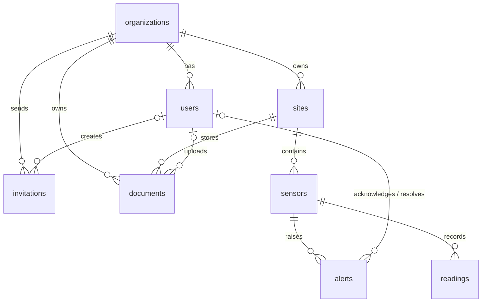

*This project has been created as part of the 42 curriculum by anamedin, dasalaza, flperez-, lylfergu, egalindo.*

# AquaGuard

> **Status:** Functional. The full stack runs with `make all`, with demo data;
> 11 of the 14 planned module points are implemented (see
> [Modules and point tracking](#modules-and-point-tracking)).

## Description

AquaGuard is a **web platform** for monitoring the water pressure of buildings
through sensors. A company (the admin) manages its client organizations, and
each client follows its own buildings, sensors and alerts.

- **Admin area (`/admin`):** KPIs and a Barcelona map of every building,
  clients with their status (trial, active, suspended), users and
  invitations, buildings and sensors floor by floor, alerts across all
  clients, and an analytics panel with charts, date ranges and CSV export.
- **Client area (`/app`):** the organization's buildings with a 7-day pressure
  chart, alerts to acknowledge and resolve, building documents, and the account
  page with data download and account deletion (GDPR).
- **Public pages:** landing page, trial sign-up, invitation acceptance, and the
  privacy and terms pages.

A simulator sends sensor readings to the API. The backend stores them in
PostgreSQL, raises alerts when a pressure goes out of range or a sensor stops
reporting, and keeps every organization's data isolated from the others. The
whole stack runs in Docker Compose behind an HTTPS Nginx gateway.

### Key features

- Login with an httpOnly session cookie, admin and client roles, and data
  isolated per organization.
- Organizations with a 7-day trial, suspension, invitations and user
  management.
- Buildings, floors and sensors, with readings ingested from a simulator.
- Automatic alerts for low pressure, high pressure and offline sensors.
- Analytics dashboard with KPIs, charts, date ranges and CSV export.
- GDPR: data download, account deletion and confirmation emails.
- Responsive Spanish interface, checked down to 375 px.
- Docker Compose deployment behind HTTPS, with health checks, a status page
  and backups.

Each feature, with who built it and how to verify it, is listed in
[Implemented features](#implemented-features).

## Instructions

### Prerequisites

- Git.
- Docker Engine with Docker Compose v2.
- Node.js and npm for running the frontend outside Docker.
- Python 3.12 for running backend or simulator components outside Docker.

### Configuration

Create the local environment file:

```bash
make env
```

For a new checkout, use `make setup`. It verifies Docker Compose, OpenSSL,
Node.js and npm; creates the local `.env` and TLS certificate; and validates
the required configuration. `make doctor` reruns those checks and also reports
the state of an already-running Compose stack.

`make env` copies `.env.example` to `.env` and replaces `SECRET_KEY` and
`INGEST_API_KEY` with random values from `openssl rand -hex 32`, so a clean
clone never runs with the keys published in the repository. It does nothing
when `.env` already exists, and `make up` or `make all` calls it for you. A plain
`cp .env.example .env` still works for development, but keeps the example keys.

`.env` is local configuration and must never be committed. `.env.example` ships
with `POSTGRES_HOST=localhost` so that Alembic or uvicorn work when run directly
on the host. Inside Docker that value is not used: `compose.yaml` overrides it
with the `database` service name for the backend service.

`SECRET_KEY` ships as `dev-only-change-me` in `.env.example`. That exact literal
is what `backend/app/core/app_config.py` checks to refuse startup when
`ENV=production`, so do not replace it with another placeholder.

`COOKIE_SECURE` is `true` because the gateway always serves HTTPS. An `.env`
created before this change keeps its old `false` until it is edited.

`INGEST_API_KEY` works the same way and ships as `dev-only-ingest-key`. It is the
key the simulator sends in the `X-Ingest-Key` header with every `POST /api/readings`
(#106): without it, or with a different one, the backend answers 401 and stores
nothing. Backend and simulator read it from the same `.env`, so in development
they match with no setup. With `ENV=production` the backend refuses to start if
it is still the example value.

The variables below configure invitations, the trial period, documents and
backups. `compose.yaml` passes them to the backend with the same defaults, so an
older `.env` without them still starts:

| Variable                | Default              | Purpose                                         |
|-------------------------|----------------------|-------------------------------------------------|
| `PUBLIC_BASE_URL`       | `https://localhost`  | Base of the invitation links                    |
| `INVITATION_TTL_DAYS`   | `7`                  | Days until an invitation expires                |
| `TRIAL_DAYS`            | `7`                  | Length of the trial after registering           |
| `DOCUMENTS_DIR`         | `/data/documents`    | Backend folder where documents are stored       |
| `MAX_UPLOAD_MB`         | `10`                 | Max document size (backend and gateway)         |
| `PUBLIC_RATE_LIMIT`     | `10r/m`              | Per-IP limit on each public form                |
| `BACKUP_INTERVAL_HOURS` | `24`                 | Hours between automatic backups                 |
| `BACKUP_KEEP`           | `7`                  | Number of backups kept                          |

The backend receives these values but does not use them yet: the features that
read them are tracked in their own issues.

Frontend-only configuration is documented in
[`frontend/.env.example`](frontend/.env.example).

### Run the complete local project

The normal local workflow is one command:

```bash
make all
```

It builds and starts PostgreSQL, backend, gateway and Mailpit, applies migrations,
loads the demo when the database is empty (no organizations and no users; never
with `ENV=production`), creates an initial backup, starts
the simulator, and verifies storage plus the end-to-end flow. Repeating it
preserves existing database rows, documents and backups. Run `make seed` only
when you explicitly want to refresh the demo.

`make down` stops the services but keeps `postgres_data`, `documents_data` and
`backups_data`. `make fclean` removes those volumes, so the next `make all`
performs a fresh bootstrap.

### Run the stack

The Compose stack declares six services on the `aquaguard` network. `database`,
`backend`, `gateway`, `backup` and `mailpit` start by default; `simulator` sits behind the
`sim` Compose profile, so a plain start never fails on it.

`gateway` is the only service published to the host for the app (Mailpit's
email viewer is also published, only on `127.0.0.1:8025`). It terminates TLS on 443,
redirects 80 to 443, serves the compiled Vue SPA, and proxies `/api/` to
`backend:8000` over the internal network. It adds the security headers (HSTS,
`X-Content-Type-Options`, `X-Frame-Options`, `Referrer-Policy`) to every HTTPS
response and limits `/api/auth/login`, `/api/auth/register` and
`/api/invitations/by-code/` to `PUBLIC_RATE_LIMIT` requests per IP, answering
429 in the API error format beyond that. Each form has its own counter, so
running out of login attempts does not block register or invitations. Login
allows a burst of 10 extra requests and the other two a burst of 4, because
everyone on the campus network shares one public IP. `client_max_body_size` is
`MAX_UPLOAD_MB` plus 1 MB for the multipart overhead, so a file of exactly
`MAX_UPLOAD_MB` is not rejected with 413; `gateway/18-upload-limit.envsh`
computes it when the container starts. The Playwright suite logs in more
often than that, so run it against a stack started with
`PUBLIC_RATE_LIMIT=1000r/m make up`. `backend` and `database` are not
reachable from the host at all. `backup` writes a compressed `pg_dump` to the
`backups_data` volume on a schedule; see
[Health checks, status page and backups](#health-checks-status-page-and-backups).

Services start in order and each one waits until the one it depends on is
`healthy`, not just started: `database` first, then `backend` and `backup`,
then `gateway` and `simulator`. The simulator never sends readings to an API
that is not answering yet. Docker logs rotate: each service keeps at most
3 files of 10 MB (about 30 MB), and the oldest one is deleted.

```bash
make up
curl --fail -k https://localhost/api/health
curl --fail -k https://localhost/api/health/db
curl --fail -k https://localhost/
make logs
```

`-k` is required because `make certs` generates a self-signed certificate for
`localhost`. A browser shows a warning on first visit, which is expected in
development and for evaluation.

There are two health endpoints. `/api/health` is liveness and does not touch
PostgreSQL, which is why a database outage cannot restart the backend in a loop.
`/api/health/db` is readiness and runs `SELECT 1`, returning 503 when the
database is unreachable:

```text
{"status":"ok","service":"AquaGuard API","version":"0.1.0"}
{"status":"ok","database":"connected","checked_at":"2026-09-02T21:52:53.859027Z"}
```

`make smoke` checks the whole stack in one run and is the check to use before
a merge or an evaluation. `make all` loads the demo data and runs it at the
end; to run it again on a stack that is already up:

```bash
make smoke
```

It runs `docker compose up -d --wait` for `database`, `backend` and `gateway`,
which starts any of them that is stopped and waits up to 60 seconds for all
three to report `healthy`. Then it checks both health endpoints, `/api/status`,
the HTTP to HTTPS redirect and the SPA, sends a reading through `POST /api/readings`, and
confirms it was stored in PostgreSQL. The test reading is deleted afterwards.
When the simulator is running (`make sim`), it also checks that its readings
reach the database, unless its scenario is `offline`, which sends none on
purpose. The first failing check stops the run with a non-zero exit code and a
message that names the logs to look at:

```text
smoke: ok    database, backend and gateway are healthy
smoke: ok    /api/health responds
smoke: ok    /api/health/db responds
smoke: ok    HTTP redirects to HTTPS
smoke: ok    the gateway serves the SPA
smoke: ok    POST /api/readings accepts a reading
smoke: ok    the reading is stored in PostgreSQL
smoke: ok    simulator readings reach the database (6 in the last 30s)
smoke: OK, all checks passed
```

Stop the stack with `make down`, which keeps the PostgreSQL volume.

The `make migrate`, `make migration` and `make migration-check` targets run
Alembic inside Docker, so they need no published port. Running Alembic directly
from the host does need the PostgreSQL port, which the delivery topology does
not publish: `make dev-infra` starts the same stack plus
[`compose.dev.yaml`](compose.dev.yaml), which binds PostgreSQL to
`127.0.0.1:5432` for that purpose only. `make dev` starts that infrastructure
and then Vite at <https://localhost:5173> with HMR. Vite proxies `/api/` through
the HTTPS gateway, so its Secure session cookie and the production API path are
preserved during frontend development.

For backend-specific local setup, Alembic checks, and API verification, see
[`backend/README.md`](backend/README.md).

### Useful commands

The root `Makefile` wraps the Compose commands:

| Target                     | Effect                                                                                                                                       |
|----------------------------|----------------------------------------------------------------------------------------------------------------------------------------------|
| `make` / `make all`        | Complete local bootstrap: services, migrations, seed on an empty database, backup, simulator, storage validation and smoke test              |
| `make up`                  | Creates `.env` and certificates if needed, then starts the base Compose services without altering application data                           |
| `make setup`               | Checks local prerequisites, creates local configuration and certificates, and validates the Compose configuration                            |
| `make config-check`        | Validates required `.env` values and rejects unsafe production placeholders                                                                  |
| `make doctor`              | Checks prerequisites, configuration and the health/state of services already running                                                         |
| `make dev-infra`           | Starts the stack with `compose.dev.yaml`, which publishes PostgreSQL on `127.0.0.1:5432` for Alembic                                         |
| `make dev`                 | Starts `make dev-infra`, installs locked frontend dependencies and runs Vite HMR at `https://localhost:5173`                                 |
| `make env`                 | Creates `.env` from `.env.example` with random `SECRET_KEY` and `INGEST_API_KEY`, only when it does not exist                                |
| `make certs`               | Generates a self-signed TLS certificate in `gateway/certs/` only when it does not exist                                                      |
| `make build`               | Builds the images without starting them                                                                                                      |
| `make sim`                 | Validates `.env`, starts the base services, seeds an empty database and then starts the sensor simulator                                     |
| `make demo`                | Alias of `make all`                                                                                                                          |
| `make seed`                | Applies pending migrations, then loads the demo data from the working tree (no rebuild needed); safe to run more than once                   |
| `make migrate`             | Applies pending migrations (`alembic upgrade head`)                                                                                          |
| `make migration MSG="..."` | Generates a migration with `alembic revision --autogenerate` without applying it; fails without `MSG`                                        |
| `make migration-check`     | Fails if the database is unreachable, has pending migrations, or the models drifted from the migrations                                      |
| `make test-backend`        | Starts PostgreSQL if necessary and runs the complete backend pytest suite in its Docker image                                                |
| `make test-frontend`       | Runs the frontend Vitest suite once                                                                                                          |
| `make test-e2e`            | Runs the Playwright tests against the running stack with a raised gateway rate limit, then restores the normal limit; needs `make all` first |
| `make lint`                | Runs ESLint on the frontend source                                                                                                           |
| `make format`              | Formats frontend JS, Vue and CSS files with Prettier                                                                                         |
| `make check`               | Runs Compose validation, frontend lint and frontend unit tests                                                                               |
| `make smoke`               | Smoke test of the stack: health, gateway, and a reading stored end to end; fails with a non-zero code                                        |
| `make storage-check`       | Verifies service mounts, demo data, document storage access and a valid persisted backup                                                     |
| `make backup`              | Runs one database backup now, in addition to the automatic ones                                                                              |
| `make backups`             | Lists the backups kept in the `backups_data` volume                                                                                          |
| `make restore FILE=...`    | Restores the database from one of those backups; see [`docs/disaster-recovery.md`](docs/disaster-recovery.md)                                |
| `make backup-verify`       | Makes a backup, restores it into a temporary database and compares every table with the real one; `FILE=...` checks an existing backup       |
| `make down`                | Stops the containers, simulator included, and keeps the PostgreSQL volume                                                                    |
| `make logs`                | Follows the logs of every running service                                                                                                    |
| `make ps`                  | Shows service status                                                                                                                         |
| `make clean`               | `down --remove-orphans`, simulator included                                                                                                  |
| `make fclean`              | `down -v --remove-orphans`, simulator included, which deletes the PostgreSQL volume, the backups and the uploaded documents                  |
| `make re`                  | `fclean` followed by `up`, a start from scratch                                                                                              |

`make fclean` destroys the database volume. PostgreSQL only creates its user on
the first initialisation of that volume, so this is also the command to run
after the credentials in `.env` change.

Certificates live in `gateway/certs/` and are git-ignored. They are mounted
read-only into the gateway instead of being baked into the image, so a private
key never reaches a built artefact.

### Health checks, status page and backups

This is the DevOps minor module "health check and status page system with
automated backups and disaster recovery procedures".

**Health checks.** Every service has one, and `docker compose ps` shows the
result:

| Service     | Check                                                                    |
|-------------|--------------------------------------------------------------------------|
| `database`  | `pg_isready` against the configured user and database                    |
| `backend`   | `GET /api/health` (liveness, does not touch PostgreSQL)                  |
| `gateway`   | `GET https://localhost/api/health` through Nginx                         |
| `simulator` | Its heartbeat file was updated recently                                  |
| `backup`    | A backup newer than `BACKUP_INTERVAL_HOURS` exists in the volume         |
| `mailpit`   | `mailpit readyz`                                                         |

`GET /api/health/db` is the readiness endpoint, and `make smoke` checks the
whole stack end to end.

**Status page.** <https://localhost/status> is public and linked from the
footer. It shows one state per component (operational, degraded or down) and
the time of the last check. It reads `GET /api/status`, which returns no
sensitive data and always answers 200, also when the database is down:

| Component   | Operational when                              | Otherwise                                        |
|-------------|-----------------------------------------------|--------------------------------------------------|
| `backend`   | The request is answered                       | Down: the page shows it when the request fails   |
| `database`  | `SELECT 1` works                              | Down                                             |
| `simulator` | A reading arrived in the last 5 minutes       | Down, with the time of the last reading          |
| `backup`    | The last backup is newer than two intervals   | Degraded if older, down if there is none         |

```bash
curl -k https://localhost/api/status
```

**Automatic backups.** The `backup` service runs `pg_dump` compressed with gzip
every `BACKUP_INTERVAL_HOURS` (24 by default) and keeps the last `BACKUP_KEEP`
(7 by default) in the `backups_data` volume, named
`aquaguard-YYYYMMDD-HHMMSS.sql.gz` in UTC. A dump is written under a temporary
name and renamed only when it finishes, so an interrupted backup is never
listed. Restarting the stack does not create an extra backup.

```bash
make backup      # one backup now
make backups     # list them
```

**Disaster recovery.** `make restore FILE=<name>` loads a backup in a single
transaction, so a failed restore leaves the database as it was:

```bash
make backups
make restore FILE=aquaguard-20261010-194544.sql.gz
make smoke
```

The full procedure, with the result of the end-to-end test (database volume
deleted, backup restored, `make smoke` passing), is in
[`docs/disaster-recovery.md`](docs/disaster-recovery.md).

**Backup verification.** `make backup-verify` proves that a backup can be
restored without touching the real database. It pauses the simulator so the
real data does not change, makes a new backup, restores
it into a temporary database (`aquaguard_restore_check`), compares the rows of
every table and the Alembic version with the real database, and drops the
temporary database and resumes the simulator at the end, also after a failure or Ctrl+C. A truncated or
damaged file, broken SQL or a dump without the schema makes it fail with a
non-zero exit code. `make backup-verify FILE=<name>` checks an existing backup
instead; its rows are shown but not compared, because the data has changed
since it was made.

```text
backup-verify: [1/7] checking that the containers are running
...
backup-verify: [7/7] counting the rows of every table

table                  real     backup
alembic_version           1          1
alerts                   26         26
organizations             5          5
readings              18765      18765
...
backup-verify: OK, aquaguard-20261023-113510.sql.gz can be restored
backup-verify: simulator running again
```

### Demo data

`make seed` (also run by `make demo`) loads `backend/seeds/seed_demo.py`. It is
idempotent, its dates are relative to the moment it runs, and it refuses to run
with `ENV=production` because these passwords are public.

| Account                                          | Password          | Role                              |
|--------------------------------------------------|-------------------|-----------------------------------|
| `admin@aquaguard.dev`                            | `dev-admin-only`  | Global admin                      |
| `client@aquaguard.dev`                           | `dev-client-only` | Client of Residencias Collserola  |
| `hotel@`, `comunidad@`, `poblenou@aquaguard.dev` | `dev-client-only` | One client per organization       |
| `zonafranca@aquaguard.dev`                       | `dev-client-only` | Disabled (suspended organization) |

- 5 organizations: Residencias Collserola, Hotel Gòtic (TRIAL), Comunidad
  Mallorca 401, Polideportivo Poblenou and Aigües Zona Franca (SUSPENDED).
- 6 buildings in Barcelona, each in a different district, with floors,
  basements and real coordinates; 8 sensors spread
  across floors, each on a floor that exists in its building (between
  `-basements` and `floors - 1`, the same rule the API applies, B3).
  `SENS-006` is out of range (its upper threshold is 2.0 bar) and `SENS-007`
  is offline. The simulator follows that story with
  `SIMULATOR_SCENARIOS`: `SENS-004` gets the `low` scenario (its alert stays
  real), `SENS-007` gets `offline` and the rest use `SIMULATOR_SCENARIO`. If
  your `.env` predates this, copy `SIMULATOR_SENSOR_IDS` and
  `SIMULATOR_SCENARIOS` from `.env.example` (`make demo` warns about it).
- 19 alerts over the last 30 days (16 resolved, 3 active), a week of hourly
  readings, and one pending invitation for `nuevo.gestor@residenciascollserola.cat`
  with the code `AQUAGUARD-DEMO-INVITE`.

### Confirmation emails (GDPR)

Downloading your data (`GET /api/me/export`) and requesting account deletion
(`POST /api/me/deletion-request`, first time only) send a plain-text
confirmation email to the account address. This is the "confirmation emails
for data operations" requirement of the GDPR minor module.

Locally and during the evaluation the emails go to **Mailpit**, a test SMTP
server in Compose that keeps every email and delivers none:

- Open <http://localhost:8025> to read them. The web UI is published only on
  `127.0.0.1`, because it shows the emails without a password; SMTP (`1025`)
  stays on the internal network.
- The backend sends in the background, after the response. With Mailpit
  stopped (`docker compose stop mailpit`) the app answers the same and the
  failure is a warning in `docker compose logs backend`.

The code only speaks standard SMTP, so real mailboxes need no code change,
just the `SMTP_*` variables in `.env`:

| Variable        | Mailpit (default)        | Real server (example)         |
|-----------------|--------------------------|-------------------------------|
| `SMTP_HOST`     | `mailpit`                | `smtp.example.com`            |
| `SMTP_PORT`     | `1025`                   | `587`                         |
| `SMTP_STARTTLS` | `false`                  | `true`                        |
| `SMTP_USER`     | empty (no login)         | the account user              |
| `SMTP_PASSWORD` | empty                    | the account password, quoted  |
| `SMTP_FROM`     | `no-reply@aquaguard.dev` | an address the server accepts |

`SMTP_FROM` is the bare address: the sender name "AquaGuard" is added by the
backend. An empty `SMTP_HOST=` disables sending; the backend only logs which
email it would have sent. Tests never send email.

### Analytics export

`GET /api/analytics/export?format=csv&from=&to=` downloads a CSV
(`Content-Disposition: attachment`) with one row per sensor and day that had
readings or alerts in the period. A client only gets its organization; an
admin gets all of them.

- `from` is included and `to` excluded (ISO 8601; a date without time zone is
  UTC). Default: the last 30 days. Maximum: 366 days.
- `format=json` returns the same rows as a JSON array (numbers, `null` for a
  sensor without readings that day). The analytics panel (F19) builds its
  KPIs and charts from it.
- `422 INVALID_DATE_RANGE` if `from >= to` or the period is too long;
  `422 VALIDATION_ERROR` for a malformed date or a `format` other than `csv`/`json`.
- The same `from`/`to` dependency (`DateRange` in `app/shared/dependencies.py`)
  is meant for `overview` and `alerts/weekly` once B9 exists.

| Column                                           | Content                                                   |
|--------------------------------------------------|-----------------------------------------------------------|
| `date`                                           | Day, `YYYY-MM-DD`, in UTC                                 |
| `organization`, `site`                           | Current names                                             |
| `sensor_id`, `sensor_external_id`, `sensor_name` | Sensor UUID, manufacturer id and name                     |
| `unit`                                           | Unit of the three pressure columns                        |
| `readings_count`                                 | Readings received that day                                |
| `pressure_min`, `pressure_avg`, `pressure_max`   | Pressure that day, 3 decimals; empty without readings     |
| `alerts_total`                                   | Alerts created that day                                   |
| `alerts_critical`, `alerts_resolved`             | Of those, how many are CRITICAL and how many are resolved |

The file starts with a UTF-8 BOM so Excel shows accents correctly.

### Frontend development

`make dev` starts the infrastructure and the Vite dev server with HMR at
<https://localhost:5173>. If the stack is already running, `make frontend-dev`
starts only Vite.

Both targets run `npm ci` in `frontend/` whenever `frontend/package-lock.json`
changes, so a pull that adds a dependency (for example `maplibre-gl` for the
sites map, #104) needs no manual `npm install`. If you start Vite another way
(`npm run dev` inside `frontend/`), run `npm install` after such a pull, or the
app fails with *"failed to resolve import maplibre-gl"*.

Before opening a PR that touches the frontend, run:

```bash
make check                       # lint, Vitest suite and Compose config
cd frontend && npx vite build    # the production build still compiles
```

A broken merge of `src/stores/sensors.js` once left `develop` unable to build
(fixed in #110); the build catches that kind of error in seconds.

### Database migrations

The backend container applies `alembic upgrade head` on every start, so
`make up` always leaves the database at the latest revision. It never generates
migrations on its own.

The migration targets run Alembic in a one-off `backend` container with
`backend/app` and `backend/migrations` mounted from the working tree, so they
always use the current models even if the image was built earlier, and a
generated file lands directly in `backend/migrations/versions/`. They require
the `database` service to be running (`make up`).

Workflow after changing a model:

```bash
make migration MSG="add sensor serial number"   # generate the revision
# review the generated file in backend/migrations/versions/
make migrate                                     # apply it
make migration-check                             # database at head, no drift
```

`make migration-check` compares column types and server defaults as well
(`compare_type` and `compare_server_default` in `backend/migrations/env.py`).
See [`backend/migrations/README.md`](backend/migrations/README.md) for details.

## Architecture

```text
Browser -> Nginx gateway -> Vue frontend
                         -> /api -> FastAPI backend -> PostgreSQL
Simulator -> readings API -> FastAPI backend
```

The backend follows a modular structure. Each domain is organized into routers,
schemas, services, repositories, and models where applicable.

**Every ORM model must be listed in `backend/app/core/models.py`.** SQLAlchemy
resolves relationships declared by name (`Mapped[list["Alert"]]`) against the
classes that have been imported, so a model missing from that module breaks
*every* database query in the application, not just queries on its own table.
The application (`app/main.py`) and Alembic (`migrations/env.py`) both import
that single module, so adding a model there covers both.

Note that tests do not catch a missing model: each test file imports the models
it needs, which builds the registry by hand. Only running the stack does.

See [`docs/architecture.md`](docs/architecture.md) for the detailed design.

## Project structure

```text
.
├── backend/       FastAPI application, database configuration, and migrations
│   └── README.md  Backend development and verification guide
├── frontend/      Vue application and client-side services
├── gateway/       Nginx and TLS configuration
├── simulator/     Deterministic sensor-data simulator
├── backup/        Scheduled PostgreSQL backups
├── docs/          Architecture, API, decisions, and implementation notes
├── scripts/       Project-management and automation scripts
├── compose.yaml   Local service orchestration
└── Makefile       Common command interface
```

## Technical stack

| Area            | Technology                              | Purpose                                      |
|-----------------|-----------------------------------------|----------------------------------------------|
| Frontend        | Vue 3, Vite, Vue Router, Pinia          | Responsive single-page application           |
| Styling         | Tailwind CSS, DaisyUI                   | Shared palette and responsive UI             |
| HTTP client     | Axios                                   | Frontend-to-backend communication            |
| Charts and maps | Chart.js, MapLibre GL + OpenFreeMap     | Analytics charts and the Barcelona sites map |
| Backend         | FastAPI, Pydantic, Uvicorn              | HTTP API, validation and OpenAPI docs        |
| Auth            | Argon2 (`argon2-cffi`), httpOnly cookie | Password hashing and session                 |
| Persistence     | PostgreSQL 16                           | Relational storage and data integrity        |
| ORM             | SQLAlchemy 2, psycopg 3                 | Database access and domain mapping           |
| Migrations      | Alembic                                 | Versioned database schema changes            |
| Email           | SMTP, Mailpit                           | GDPR confirmation emails, caught locally     |
| Tests           | Pytest, Vitest, Playwright              | Backend, frontend unit and end-to-end tests  |
| Code quality    | ESLint, Prettier                        | Frontend linting and formatting              |
| Deployment      | Docker Compose, Nginx                   | Container orchestration and HTTPS gateway    |

The main technical decisions and their reasons are recorded as ADRs in
[`docs/decisions`](docs/decisions):

- [0001](docs/decisions/0001-auth-cookie.md): session in an httpOnly, Secure,
  SameSite cookie instead of a JWT in `localStorage`.
- [0002](docs/decisions/0002-uuid-claves-primarias.md): UUID primary keys.
- [0003](docs/decisions/0003-header-landing-degradado-vs-imagen.md): landing
  header with a gradient instead of an image.
- [0004](docs/decisions/0004-reglas-migraciones.md): rules for writing
  migrations.

## Database schema

PostgreSQL holds 8 tables, defined as SQLAlchemy models in
`backend/app/modules/*/model.py` and created by the Alembic revisions in
`backend/migrations/versions/`. Every primary key is a UUID
([ADR 0002](docs/decisions/0002-uuid-claves-primarias.md)), every timestamp is
`timestamptz`, and the rules for new migrations are in
[ADR 0004](docs/decisions/0004-reglas-migraciones.md).



| Table           | Key fields                                                                                                       | Rules enforced by the database                                                                                    |
|-----------------|------------------------------------------------------------------------------------------------------------------|-------------------------------------------------------------------------------------------------------------------|
| `organizations` | `name`, `status`, `trial_ends_at`, contact and billing data, `plan`, `iban_masked`                               | `name` unique ignoring case; `status` in TRIAL/ACTIVE/SUSPENDED; `plan` in BASIC/PRO/ENTERPRISE                   |
| `users`         | `organization_id`, `email`, `name`, `password_hash`, `role`, `is_active`, terms and deletion dates               | `email` unique; `role` is `admin` or `client`; a client always has an organization                                |
| `sites`         | `organization_id`, `name`, `address`, `latitude`/`longitude`, `floors`, `basements`, `building_type`, `district` | `name` unique per organization; valid coordinates; at least 1 floor; building type and Barcelona district lists   |
| `sensors`       | `site_id`, `external_id`, `name`, `floor`, `sensor_type`, `unit`, `low_threshold`, `high_threshold`              | `external_id` unique per site; `low_threshold < high_threshold`, both within 0–25 bar; type PRESSURE or FLOW      |
| `readings`      | `sensor_id`, `value` (`numeric(10,3)`), `unit`, `recorded_at`, `created_at`                                      | The client-generated `id` makes ingestion idempotent; indexed by sensor and time for history and the offline rule |
| `alerts`        | `sensor_id`, `alert_type`, `status`, `severity`, `message`, acknowledged and resolved date and user              | Type LOW_PRESSURE/HIGH_PRESSURE/SENSOR_OFFLINE; status ACTIVE/RESOLVED; severity WARNING/CRITICAL                 |
| `invitations`   | `organization_id`, `email`, `code_hash`, `expires_at`, `accepted_at`, `revoked_at`, `created_by`                 | `code_hash` unique; email stored lowercase; one pending invitation per organization and email                     |
| `documents`     | `organization_id`, `site_id`, `kind`, `filename`, `content_type`, `size`, `storage_key`                          | `storage_key` unique; `kind` in PLAN/REPORT/INVOICE/PHOTO/OTHER; `size >= 0`                                      |

**Deleting data.** Links to a user (who acknowledged an alert, created an
invitation or uploaded a document) become `NULL` when that user is deleted.
Invitations and documents are deleted with their organization or building.
Every other link is `RESTRICT`, so organizations, buildings and sensors with
data cannot be deleted by accident: `purge_organization`
(`backend/app/modules/organizations/purge.py`, B16) deletes an organization
and all its data in order, in one transaction.

## Implemented features

Every row is checked on a stack started with `make all`, logged in as the
users in [Demo data](#demo-data). Backend rules are covered by
`make test-backend`; the details of each feature are in its issue.

| Area           | Feature                                                                               | Contributors           | Verification                                 |
|----------------|---------------------------------------------------------------------------------------|------------------------|----------------------------------------------|
| Infrastructure | Docker Compose stack: six services, named volumes and the `sim` profile (#19)         | Eduardo                | `make all` · `make ps`                       |
| Infrastructure | Nginx gateway: HTTPS, 80 → 443, SPA, `/api` proxy, security headers, rate limit       | Eduardo                | `curl -I http://localhost` → 301             |
| Infrastructure | Health checks on every service and end-to-end smoke test (#21)                        | Eduardo                | `make smoke`                                 |
| Infrastructure | Status page, automatic backups and disaster recovery (#154)                           | Eduardo                | `/status` · `make backup` · `make restore`   |
| Infrastructure | Sensor simulator: normal, low, high and offline scenarios (#89)                       | Eduardo                | `cd simulator && pytest` · `/status`         |
| Backend        | Common contract and OpenAPI docs: shared enums, filters, examples (B0, B13)           | Ana, Daruny            | `/api/docs`                                  |
| Backend        | Auth: register, login, logout and `GET /api/me` with an httpOnly session cookie (#26) | Ana                    | `make test-backend`                          |
| Backend        | Permissions: admin sees every organization, client only its own (#27)                 | Ana                    | `make test-backend`                          |
| Backend        | Organizations: list, create, edit, suspend, reactivate and trial (B1)                 | Ana                    | `/admin/clients`                             |
| Backend        | Expired trial is read-only: client writes answer `403 TRIAL_EXPIRED` (B12)            | Daruny                 | `make test-backend`                          |
| Backend        | Invitations and user management: invite, revoke, resend and accept (B4, B6)           | Daruny                 | `/registro?invitacion=AQUAGUARD-DEMO-INVITE` |
| Backend        | Subscription plans and global search, API only for now (B14, B17)                     | Daruny                 | `/api/docs` → Subscriptions, Search          |
| Backend        | Buildings: floors, basements, type, sensor count and status (B2)                      | Ana                    | `/admin/sites`                               |
| Backend        | Building documents: upload, list, download and delete (B11)                           | Daruny                 | `/app/documents`                             |
| Backend        | Sensors: create, edit, floor, health and last value; offline after 5 min (B3)         | Ana                    | `/admin/sensors`                             |
| Backend        | Alerts: low/high pressure and offline rules, acknowledge and resolve (#28, B5)        | Daruny, Ana            | `/admin/alerts`                              |
| Backend        | Analytics: KPIs, charts, date range and CSV/JSON export (B9, B18, F19)                | Daruny, Ana            | `/admin` → Exportar CSV                      |
| Backend        | GDPR: export my data, request deletion and confirmation emails (B15, B19)             | Daruny, Florinda       | `/app/account` · <http://localhost:8025>     |
| Database       | Schema: 8 tables with constraints, indexes and Alembic migrations (#129, #130, #132)  | Daruny                 | `make migration-check`                       |
| Database       | Alembic targets: migrate, generate and check for drift (#92)                          | Eduardo                | `make migrate` · `make migration-check`      |
| Database       | Idempotent demo seed: 5 clients, 6 buildings, 8 sensors, 30 days of alerts (D6, #131) | Daruny                 | `make seed`                                  |
| Database       | Purge: delete an organization and all its data in one transaction (B16, D9)           | Daruny                 | `/admin/clients/:id` → Acciones              |
| Database       | Readings: ingest with the simulator key, history and chart series (#24, B7)           | Daruny, Ana            | `make smoke`                                 |
| Frontend       | Public: landing page, fixed header and legal page with privacy and terms (#195)       | Florinda               | `/` · `/legal`                               |
| Frontend       | Public: trial sign-up and invitation acceptance, shared password rule (F15-P, F6)     | Florinda               | `/prueba` · `/registro`                      |
| Frontend       | Auth UI: login, logout, route guards and role-based redirects (#99, #174)             | Lylia                  | `/login` · `/admin` as a client              |
| Frontend       | Admin dashboard: KPI cards, active alerts and the Barcelona sites map (#156)          | Florinda, Eduardo, Ana | `/admin`                                     |
| Frontend       | Admin clients: status filters, detail tabs, status actions and new-client wizard (F7) | Florinda, Lylia        | `/admin/clients`                             |
| Frontend       | Admin client users: list, edit name and role, remove access (F23)                     | Daruny                 | `/admin/clients/:id` → Usuarios              |
| Frontend       | Admin buildings and sensors floor by floor, pressure chart and forms (F4, F5, F10)    | Florinda               | `/admin/sites` · `/admin/sensors`            |
| Frontend       | Admin alerts: client, state and severity filters, counters and sensor ranking (#153)  | Lylia, Eduardo         | `/admin/alerts`                              |
| Frontend       | Client home "Mis edificios": alert banner, KPIs, buildings by urgency (F8, F24)       | Daruny, Florinda       | `/app` · `client@aquaguard.dev`              |
| Frontend       | Client alerts: one week per building with a day-by-day grid (F9-C)                    | Daruny                 | `/app/alerts`                                |
| Frontend       | Client documents: list, upload and delete the organization's files                    | Lylia                  | `/app/documents`                             |
| Frontend       | Account: name, password and privacy card, for admin and client (F13-C)                | Florinda               | `/app/account` · `/admin/account`            |
| Frontend       | UI components: `DataTable`, `Tabs`, `StatusPill`, `AlertRow`, async states (F3)       | Florinda               | `/admin/alerts`                              |
| Frontend       | Shared palette and the new design for public views and panels (F18–F20)               | Florinda               | `make lint` · any page                       |
| Frontend       | Spanish formats, keyboard focus and responsive review down to 375 px (F18)            | Florinda               | DevTools at 375 px                           |
| Other          | E2E: Playwright tests for login, register, logout, guards and roles (#41)             | Eduardo                | `make test-e2e`                              |

Every pull request that adds a feature should add or update its row here, with its area,
contributors, and a reproducible verification method.

## Modules and point tracking

The project must reach at least 14 validated points. The following selection is
the team's current AquaGuard plan, based on the product architecture document.
It adds up to 14: the real-time module (WebSockets, 2 points) was dropped from
the plan, and the GDPR minor module (B19) brings the missing point.

| Category           | Module                                          | Type  | Points | Status                           | Contributors                          |
|--------------------|-------------------------------------------------|-------|-------:|----------------------------------|---------------------------------------|
| DevOps             | Health checks, status page and backups          | Minor |      1 | Implemented                      | Eduardo                               |
| Web                | Frontend and backend frameworks (Vue + FastAPI) | Major |      2 | Implemented                      | Ana, Florinda, Lylia, Daruny, Eduardo |
| Web                | ORM (SQLAlchemy)                                | Minor |      1 | Implemented                      | Daruny                                |
| Web                | Advanced search                                 | Minor |      1 | Partial - API only, no UI        | Ana, Daruny, Florinda, Lylia          |
| Web                | Notification system                             | Minor |      1 | Not started                      | Ana, Daruny, Florinda, Lylia          |
| User Management    | Advanced permissions                            | Major |      2 | Implemented                      | Ana, Daruny, Lylia                    |
| User Management    | Organization system                             | Major |      2 | Implemented                      | Ana, Daruny                           |
| User Management    | GDPR compliance features                        | Minor |      1 | Implemented                      | Daruny, Florinda                      |
| Data and Analytics | Advanced analytics dashboard                    | Major |      2 | Implemented                      | Ana, Daruny, Florinda, Lylia          |
| Data and Analytics | Data export and import                          | Minor |      1 | Partial - export only, no import | Ana, Daruny, Florinda, Lylia          |
|                    | **Planned total**                               |       | **14** |                                  |                                       |
|                    | **Implemented so far**                          |       | **11** |                                  |                                       |

### Module implementation plan

- **Frontend and backend frameworks:** Vue 3/Vite and FastAPI/Pydantic provide
  the SPA and modular backend foundations.
- **ORM:** SQLAlchemy maps the domain models to PostgreSQL and isolates database
  access behind repositories.
- **Advanced permissions:** demonstrated with `make all` and the demo users.
  - *View, edit and delete users:* `admin@aquaguard.dev` → Clientes → a
    client → Usuarios lists its users; "Editar" changes the name and
    "Quitar acceso" deletes the user, who can no longer log in (F23, B6).
  - *Roles management:* the same "Editar" switches a user between `client`
    and `admin`. An admin cannot demote or delete themself (409).
  - *Different views and actions per role:* an admin works in `/admin` across
    every organization; a client only sees `/app` with its own data, and
    opening `/admin` redirects it (route guards, `require_role` and
    `get_org_scope` in the API).
- **Organization system:** demonstrated from Clientes in the admin area.
  - *Create, edit and delete organizations:* "+ Nuevo cliente", the client
    detail, and Acciones → "Eliminar…" (F7, B1, B16).
  - *Add users:* Usuarios → "Crear invitación" gives a link; accepting it
    creates the user inside that organization (B4).
  - *Remove users:* Usuarios → "Quitar acceso" (F23).
  - *Actions inside the organization:* a client reads its buildings, sensors
    and alerts, acknowledges and resolves alerts, uploads documents and edits
    its account, always limited to its own organization.
- **Advanced analytics dashboard:** demonstrated in `/admin` as
  `admin@aquaguard.dev` (B9, B18, F19).
  - *Interactive charts:* alerts per day (line), by severity (pie) and per
    client or sensor (bar), built with Chart.js, with tooltips.
  - *Date ranges:* the 7, 30 and 90-day presets or a custom from/to reload
    the KPIs and every chart.
  - *Export:* "Exportar CSV" downloads the chosen period
    (see [Analytics export](#analytics-export)).
  - *Real-time updates:* the panel refreshes every 30 s and pauses while the
    tab is hidden.
  - A client sees the same KPIs for its own organization in `/app`.
- **Advanced search:** *partial, API only.* `GET /api/search?q=&limit=`
  (B17) searches clients, buildings and sensors at once, ignoring case, and
  returns the first `limit` of each type plus the total. A client only finds
  its own buildings and sensors. No screen uses it yet; to claim the module it
  still needs a UI with filters, sorting and pagination.
- **Data export and import:** *partial, export only.*
  `GET /api/analytics/export` returns the readings and alerts of a period as
  CSV or JSON, scoped to the user's organization (B18). Import is not
  implemented.
- **Notification system:** *not started.* Alerts are shown when the admin or
  client area is opened, but creating, updating or deleting data does not
  generate notifications for the user.
- **Health checks, status page and backups:** Every service has a health check,
  `/status` shows the state of each component, and the database is backed up
  on a schedule with a tested restore procedure.
- **GDPR compliance features:** Users download their data as readable JSON
  and request account deletion with an on-page confirmation (B15, F13-C), and
  both operations send a confirmation email (B19). See
  [Confirmation emails (GDPR)](#confirmation-emails-gdpr).

### Dependencies and validation evidence

- The vertical slice must work first: simulator -> API -> PostgreSQL -> API ->
  Vue.
- Authentication, roles, and organization isolation are prerequisites for the
  permissions and organization modules.
- Readings and alerts must be persisted before analytics can be demonstrated.
- Advanced search and export/import depend on stable domain endpoints and
  validated data contracts.
- Every claimed module must include tests, a reproducible demo path, and the
  responsible contributors in this section.

The DevOps health/status system (health checks, status page, automated backups
and disaster recovery, 1 point) is implemented and described in
[Health checks, status page and backups](#health-checks-status-page-and-backups).
It counts towards the planned total above. Major modules are worth 2 points and
minor modules are worth 1 point.

## Team information

The working areas below follow the current project planning documentation. The
team must confirm the formal PO, PM/Scrum Master, Technical Lead/Architect, and
Developer role assignments before submission.

| Member                | Role(s)                                   | Responsibilities                                                                                                                  |
|-----------------------|-------------------------------------------|-----------------------------------------------------------------------------------------------------------------------------------|
| Ana (`anamedin`)      | Product Owner, Backend/API Developer      | FastAPI routes, schemas, business rules, and backend tests.                                                                       |
| Daruny (`dasalaza`)   | Team Lead, Database/Persistence Developer | PostgreSQL, SQLAlchemy, Alembic, domain models, repositories, and simulator integration.                                          |
| Florinda (`flperez-`) | Frontend Team Lead, Frontend UI Developer | Vue views, layouts, reusable components, responsive design, and accessibility.                                                    |
| Lylia (`lylfergu`)    | Frontend Integration Developer            | Pinia stores, services, adapters, authentication/navigation flows, and frontend integration tests.                                |
| Eduardo (`egalindo`)  | DevOps/Infrastructure Developer           | Docker Compose, Nginx/HTTPS, simulator, migrations, backups, health checks, smoke and E2E tests, admin alerts and dashboard KPIs. |

Required roles are Product Owner, Project Manager/Scrum Master, Technical Lead /
Architect, and Developers. One member may hold multiple roles.

## Project management

- **Task tracking:** GitHub Issues and pull requests.
- **Work breakdown:** Small, reviewable issues linked to pull requests.
- **Code review:** At least one team member reviews important changes.
- **Meetings:** TBD - record the agreed frequency here.
- **Communication:** TBD - record the agreed channel here.
- **Branching and commits:** TBD - record the team convention here.

Important architectural decisions are recorded in [`docs/decisions`](docs/decisions).

## Individual contributions

### Ana (`anamedin`)

| Issue      | Contribution                                                                                   | Pull requests  | Status      |
|------------|------------------------------------------------------------------------------------------------|----------------|-------------|
| #22        | FastAPI modular architecture (8 routers), unified error format and health checks               | #46            | Implemented |
| #23        | Pydantic schemas and OpenAPI contract, including schemas published before their routes         | #46            | Implemented |
| #24        | `POST /api/readings`: stores the reading, idempotent by `id`, evaluates alert rules            | #72            | Implemented |
| #25        | `GET /api/sensors`, `GET /api/sensors/{id}` and reading history; `OFFLINE` after 5 minutes     | #77, #113      | Implemented |
| #26        | Register, login, logout and `GET /api/me`: Argon2 hashing, signed httpOnly session cookie      | #75, #79       | Implemented |
| #27        | Roles and per-organization isolation (`require_role`, `get_org_scope`)                         | #105           | Implemented |
| #28        | Alerts: list, acknowledge, resolve; `LOW_PRESSURE`/`HIGH_PRESSURE` and `SENSOR_OFFLINE` rules  | #78, #98, #118 | Implemented |
| #29        | Sites, sensors of a site, sensor create and edit                                               | #108, #115     | Implemented |
| #30        | Pytest coverage of critical routes                                                             | #109, #114     | Implemented |
| #106       | `POST /api/readings` requires the simulator key (`X-Ingest-Key`)                               | #116           | Implemented |
| #138       | B0 common contract: shared enums, `q`/`organization_id`/`site_id` filters, `*_name` fields     | #180           | Implemented |
| #139       | B1 organizations: list with counters, create with first site, edit, suspend/reactivate, trial  | #191           | Implemented |
| #139       | B2 buildings: create, edit and delete sites, floors and building type, sensor count and status | #194           | Implemented |
| #139       | B3 sensors: floor on create and edit, health, last value and health filter                     | #197           | Implemented |
| #140       | B10 public register: own organization on a 7-day trial, session opened, common password rule   | #205           | Implemented |
| —          | List of the redesign issues (B0–B18) and their mocks                                           | #124           | Implemented |
| —          | Cleanup: outdated comments, dead 501 code, notes in `docs/ana/` brought up to date             | #181           | Implemented |
| #141, #144 | Contract and routes of B4, B6, B8 and B9: invitations, users, my account and KPIs              | —              | Implemented |
| #150       | B14 subscription (plans, fiscal data, masked IBAN) and B17 global search (optional)            | —              | Implemented |

Notes for each issue, with diagrams and the decisions taken, are in [`docs/ana/`](docs/ana/).


### Daruny (`dasalaza`)

Issues #130 to #134 were reviewed and merged together in #182.

| Issue | Contribution                                                                                     | Pull requests | Status      |
|-------|--------------------------------------------------------------------------------------------------|---------------|-------------|
| #11   | PostgreSQL + SQLAlchemy: shared `Engine`, per-request `Session` via `get_db()`, env-based config | #43           | Implemented |
| #12   | Alembic configured against the app's `Settings` and metadata, first revision                     | #44           | Implemented |
| #13   | Domain models `Organization`, `User`, `Site`, `Sensor`, `Reading`, `Alert` with FKs and indexes  | #48           | Implemented |
| #14   | `SensorRepository` and `ReadingRepository`: tenant-isolated queries and stable pagination        | #55           | Implemented |
| #15   | Development seed: 1 organization, Admin + Client users, 2 sites, 3 sensors                       | #59           | Implemented |
| #17   | User and organization repositories: normalized email, isolated lookup and creation               | #65, #76      | Implemented |
| #18   | `Alert` model and repository                                                                     | #66           | Implemented |
| #97   | `sensors` table aligned with the API contract: type, required thresholds and range CHECKs        | #112          | Implemented |
| —     | `organizations.name` widened to 120 with a case-insensitive unique index on `lower(name)`        | #123          | Implemented |
| #129  | Migration rules (ADR 0004) and new columns: organization status, trial, floors, user state       | #172          | Implemented |
| #130  | D3 `invitations` table: unique `code_hash`, one pending invitation per organization and email    | #182          | Implemented |
| #131  | D6 demo seed: 5 clients, 6 buildings, 8 sensors, 30 days of alerts; blocked in production        | #182          | Implemented |
| #132  | D4 `documents` table: metadata of each building's files, CASCADE from `sites`                    | #182          | Implemented |
| #133  | D9 `purge_organization`: deletes an organization and all its data in one transaction             | #182          | Implemented |
| #134  | B18 analytics: shared `DateRange` (`from`/`to`) and `GET /api/analytics/export` in CSV           | #182          | Implemented |
| #135  | F19 admin analytics panel: Chart.js charts, date presets, CSV export, 30 s refresh               | #186          | Implemented |
| #148  | B13 complete OpenAPI documentation: examples, error codes, multipart upload and CSV export       | #228          | Implemented |

### Florinda (`flperez-`)

| Issue    | Contribution                                                                                              | Pull requests | Status      |
|----------|-----------------------------------------------------------------------------------------------------------|---------------|-------------|
| #2       | Vue, Vite, Router, Tailwind and DaisyUI frontend setup                                                    | #42           | Implemented |
| #3       | Shared layouts and visual components                                                                      | #47           | Implemented |
| #4       | `SensorCard` and basic sensor detail view                                                                 | #56           | Implemented |
| #5       | Public landing page: hero, value proposition, links to login/register; `Header`/`Footer`/`Card` slots     | #63           | Implemented |
| #6       | Privacy Policy and Terms of Service: semantic sections, sticky index, linked from the footer              | #70           | Implemented |
| #7       | Admin dashboard structure: `AdminLayout`, `KPICard`, shared `AppIcon` set, sites/sensors/alerts summaries | #96           | Implemented |
| #8, #107 | Admin sites map: MapLibre GL + OpenFreeMap, Barcelona boundary, markers by alert, lazy-loaded modal       | #104, #117    | Implemented |
| #9       | Admin clients and sites views: `ClientsList`, client detail, router-based `Sidebar` with active entry     | #128          | Implemented |
| #37      | Shared async states `LoadingState`, `ErrorState` (retry + focus restore) and `EmptyState`                 | #125          | Implemented |

### Lylia (`lylfergu`)

| Issue | Contribution                                                                             | Pull requests | Status      |
|-------|------------------------------------------------------------------------------------------|---------------|-------------|
| #31   | Pinia setup and centralized global stores                                                | #49           | Implemented |
| #32   | Axios API layer: services, adapters and common error handling                            | #57           | Implemented |
| #33   | MockAdapter with the same interface as the real API, fixtures and pagination             | #62           | Implemented |
| #35   | Login, register and logout: Auth store, loading/error states, no double submission       | #99           | Implemented |
| #36   | Route guards and role-based navigation, session initialization and 404 page              | #174          | Implemented |
| #38   | Admin sensors and alerts views with filters and loading/error/empty states               | #187          | Implemented |
| #39   | Client dashboard: sensors, active alerts and reading history, independent section states | #214          | Implemented |
| #158  | F1+F2 router and data layer: users/documents services and stores, URL query state        | #227          | Implemented |
| #159  | F0 client layout: organization name, trial info, active alerts counter, sidebar routes   | #235          | Implemented |
| #164  | F14 client documents: list, upload and delete, count updated after each change           | #254          | Implemented |
| #250  | Admin dashboard reorganized: summaries removed, map height and icons refined             | #255          | Implemented |
| #253  | New client wizard: required fields, phone format and address validation                  | #257          | Implemented |

### Eduardo (`egalindo`)

| Issue    | Contribution                                                                                         | Pull requests | Status      |
|----------|------------------------------------------------------------------------------------------------------|---------------|-------------|
| #19      | Docker Compose stack: services on the `aquaguard` network, volumes, `.env.example`, first `Makefile` | #52           | Implemented |
| #20      | Nginx gateway: TLS 1.2/1.3, 80 → 443 redirect, compiled SPA and `/api/` proxy                        | #61           | Implemented |
| #89, #16 | Sensor simulator: `normal`, `low`, `high` and `offline` scenarios, idempotent reading ids            | #101          | Implemented |
| #92      | Alembic targets: `make migrate`, `make migration MSG=...` and `make migration-check`                 | #102          | Implemented |
| #21      | Health checks and `make smoke`: health endpoints, redirect, SPA and a reading stored end to end      | #103          | Implemented |
| #41      | Playwright E2E suite: login, register, logout, guards and role redirects on the real stack           | #127          | Implemented |
| #151     | Environment variables for invitations, trial, documents and backups; `make env` generates keys       | #183          | Implemented |
| #154     | Status page, `GET /api/status`, `backup` service and `make backup`/`backups`/`restore`               | #184          | Implemented |
| #155     | Gateway rate limit with JSON 429, HSTS and security headers, `documents_data` volume                 | #189          | Implemented |
| #153     | Admin alerts view: client filter, counters, sensor ranking and open-alerts counter                   | #196, #207    | Implemented |
| #156     | Admin dashboard KPIs from `GET /api/analytics/overview` and sites from `GET /api/sites`              | #220          | Implemented |
| #243     | Startup order: the simulator waits for a healthy backend, `simulator/.dockerignore`                  | #261          | Implemented |
| #245     | Docker log rotation: `json-file` driver, 10 MB × 3 files per service                                 | #261          | Implemented |
| #244     | `make backup-verify`: restores a backup into a temporary database and compares every table           | #269          | Implemented |

## Resources

### Technical resources

- 42 `ft_transcendence` subject, version 21.1.
- [FastAPI documentation](https://fastapi.tiangolo.com/)
- [Vue documentation](https://vuejs.org/guide/introduction.html)
- [SQLAlchemy documentation](https://docs.sqlalchemy.org/)
- [Alembic documentation](https://alembic.sqlalchemy.org/)
- [Docker Compose documentation](https://docs.docker.com/compose/)
- [MapLibre GL JS documentation](https://maplibre.org/maplibre-gl-js/docs/)
- [OpenFreeMap](https://openfreemap.org/) (map tiles, OpenStreetMap data)
- Barcelona municipal boundary: Ajuntament de Barcelona / CartoBCN (CC-BY)

### AI usage

AI tools may be used as an assistant for research, brainstorming, repetitive
tasks, debugging hypotheses, test ideas, and documentation drafts. Every
AI-assisted change must be reviewed, understood, tested, and approved by the
team. The team remains responsible for all submitted code and documentation.

This subsection must be updated with the concrete tools, tasks, and project
parts where AI was used. Do not claim AI-generated work that was not reviewed by
the team.

## Development rules for README updates

Each pull request should update the README when it changes any of the following:

- How the project is installed, configured, run, or tested.
- An implemented feature or its verification procedure.
- The database schema or architecture.
- A selected module, its point value, or its justification.
- Team roles, project-management practices, or individual contributions.
- Resources or AI usage.

Keep this document in English, use exact commands that have been tested, and
label planned work separately from implemented work.

## Supported browsers

The frontend is checked in the latest stable Chrome and Firefox (the browsers required by the subject)
(desktop, plus the responsive mode of each browser at 768 px and 375 px).
Browser-specific limitations:

- The admin sites map uses MapLibre GL, which needs WebGL. If WebGL is
  disabled (or hardware acceleration is off in the browser settings), the map
  area stays empty; the rest of the dashboard keeps working.
- The analytics date range uses the native `<input type="date">`, so the date
  picker looks different in each browser; the value and validation are the same.
- "Copiar enlace" uses the Clipboard API, which browsers only allow on HTTPS or
  `localhost`. On plain HTTP it falls back to the older copy command and, if the
  browser blocks it too, the link stays selected so it can be copied by hand.
- Edge and Safari are not part of the review.

## Known limitations

- The `simulator` service sits behind the `sim` profile. `make all`,
  `make demo` and `make sim` start it; a plain `make up` does not.
- TLS certificates are self-signed, so browsers warn on first visit. A
  publicly trusted certificate is out of scope for this project.
- The admin sites map loads its tiles from OpenFreeMap, so it needs an
  internet connection.
- The gateway serves a production build of the SPA, so frontend changes need
  `make dev` (Vite with HMR) or a rebuild of the gateway to show up.
- By default, emails (GDPR confirmations) are caught by Mailpit at
  <http://localhost:8025> and never reach a real mailbox. Sending them for real
  only needs the `SMTP_*` variables in `.env` (see
  [Confirmation emails (GDPR)](#confirmation-emails-gdpr)).
- Subscription plans and global search exist only in the API (B14, B17); no
  screen uses them yet.
- Data export is CSV/JSON only; there is no import.
- There is no notification system yet: alerts are only seen by opening the
  admin or client area.
- Backups live in a Docker volume on the same host as the database. They
  survive the loss of the database volume, but not the loss of the host or
  `make fclean`; `docs/disaster-recovery.md` explains how to copy them out.
- The README placeholders must be completed by the team.

## License

This project is developed for the 42 curriculum. License information: TBD.
