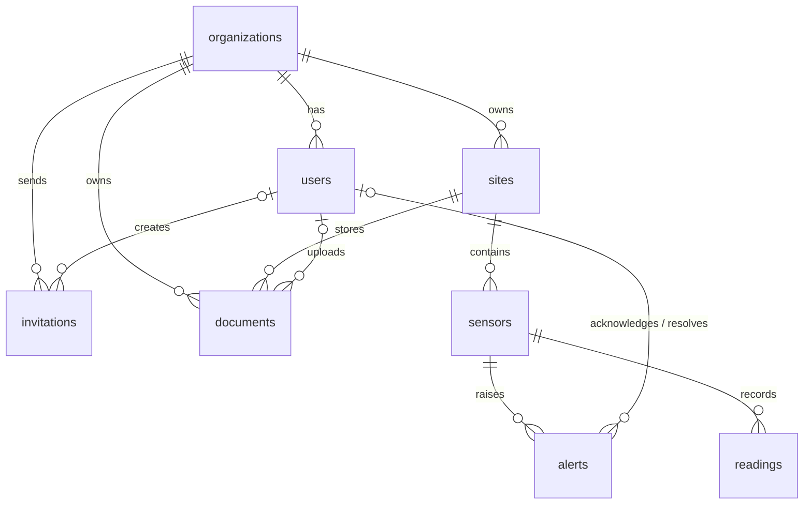

*This project has been created as part of the 42 curriculum by anamedin, dasalaza, flperez-, lylfergu, egalindo.*

# AquaGuard

> **Status:** Functional. The full stack runs with `make all`, with demo data;
> 21 of the 22 claimed module points are implemented (see
> [Modules and point tracking](#modules-and-point-tracking)).

## Description

AquaGuard is a **web platform** for monitoring the water pressure of buildings
through sensors. A company (the admin) manages its client organizations, and
each client follows its own buildings, sensors and alerts.

- **Admin area (`/admin`):** KPIs and a Barcelona map of every building,
  clients with their status (trial, active, suspended), users and
  invitations, buildings and sensors floor by floor, alerts across all
  clients, and an analytics panel with charts, date ranges and CSV export.
- **Client area (`/app`):** the organization's buildings with a 7-day pressure
  chart, alerts to take charge of (only AquaGuard closes them), building documents, and the account
  page with data download and account deletion (GDPR).
- **Public pages:** landing page, trial sign-up, invitation acceptance, and the
  privacy and terms pages.

A simulator sends sensor readings to the API. The backend stores them in
PostgreSQL, raises alerts when a pressure goes out of range or a sensor stops
reporting, and keeps every organization's data isolated from the others. The
whole stack runs in Docker Compose behind an HTTPS Nginx gateway.

### Key features

- Login with an httpOnly session cookie, admin and client roles, and data
  isolated per organization.
- Organizations with a 7-day trial, suspension, invitations and user
  management.
- Self-service subscription: a trial client chooses how many buildings and
  sensors it needs; the plan and the monthly price are computed from them and
  become its limits.
- Buildings, floors and sensors, with readings ingested from a simulator.
- Automatic alerts for low pressure, high pressure and offline sensors.
- Analytics dashboard with KPIs, charts, date ranges and CSV export.
- GDPR: data download, account deletion and confirmation emails.
- Responsive Spanish interface, checked down to 375 px.
- Docker Compose deployment behind HTTPS, with health checks, a status page
  and backups.

Each feature, with who built it and how to verify it, is listed in
[Implemented features](#implemented-features).

## Instructions

### Prerequisites

- Git.
- Docker Engine with Docker Compose v2 (`docker compose`).
- Make and : `make setup` checks both, and `make env` uses OpenSSL
  to generate the keys.
- Node.js 24 and npm 11 or newer (`engines` in `frontend/package.json`), only
  for running the frontend or the E2E tests outside Docker.
- Python 3.12, only for running backend or simulator components outside Docker.
- Google Chrome (latest stable); Firefox and Brave are also supported.

### Configuration

Create the local environment file:

```bash
make env
```

For a new checkout, use `make setup`. It verifies Docker Compose, OpenSSL,
Node.js and npm; creates the local `.env` and TLS certificate; and validates
the required configuration. `make doctor` reruns those checks and also reports
the state of an already-running Compose stack.

`make env` copies `.env.example` to `.env` and replaces `SECRET_KEY` and
`INGEST_API_KEY` with random values from `openssl rand -hex 32`, so a clean
clone never runs with the keys published in the repository. It does nothing
when `.env` already exists, and `make up` or `make all` calls it for you. A plain
`cp .env.example .env` still works for development, but keeps the example keys.

`.env` is local configuration and must never be committed. `.env.example` ships
with `POSTGRES_HOST=localhost` so that Alembic or uvicorn work when run directly
on the host. Inside Docker that value is not used: `compose.yaml` overrides it
with the `database` service name for the backend service.

`SECRET_KEY` ships as `dev-only-change-me` in `.env.example`. That exact literal
is what `backend/app/core/app_config.py` checks to refuse startup when
`ENV=production`, so do not replace it with another placeholder.

`COOKIE_SECURE` is `true` because the gateway always serves HTTPS. An `.env`
created before this change keeps its old `false` until it is edited.

`INGEST_API_KEY` works the same way and ships as `dev-only-ingest-key`. It is the
key the simulator sends in the `X-Ingest-Key` header with every `POST /api/readings`
(#106): without it, or with a different one, the backend answers 401 and stores
nothing. Backend and simulator read it from the same `.env`, so in development
they match with no setup. With `ENV=production` the backend refuses to start if
it is still the example value.

The variables below configure invitations, the trial period, documents and
backups. `compose.yaml` passes them to the backend with the same defaults, so an
older `.env` without them still starts:

| Variable                | Default              | Purpose                                         |
|-------------------------|----------------------|-------------------------------------------------|
| `PUBLIC_BASE_URL`       | `https://localhost`  | Base of the invitation links                    |
| `INVITATION_TTL_DAYS`   | `7`                  | Days until an invitation expires                |
| `TRIAL_DAYS`            | `7`                  | Length of the trial after registering           |
| `DOCUMENTS_DIR`         | `/data/documents`    | Backend folder where documents are stored       |
| `MAX_UPLOAD_MB`         | `10`                 | Max document size (backend and gateway)         |
| `PUBLIC_RATE_LIMIT`     | `10r/m`              | Per-IP limit on each public form                |
| `BACKUP_INTERVAL_HOURS` | `24`                 | Hours between automatic backups                 |
| `BACKUP_KEEP`           | `7`                  | Number of backups kept                          |

All of them are in use: the backend reads the invitation, trial and document
values, the gateway applies `MAX_UPLOAD_MB` and `PUBLIC_RATE_LIMIT`, and the
`backup` service uses `BACKUP_INTERVAL_HOURS` and `BACKUP_KEEP`.

Frontend-only configuration is documented in
[`frontend/.env.example`](frontend/.env.example).

### Run the complete local project

The normal local workflow is one command:

```bash
make all
```

It builds and starts PostgreSQL, backend, gateway and Mailpit, applies migrations,
loads the demo when the database is empty (no organizations and no users; never
with `ENV=production`), creates an initial backup, starts
the simulator, and verifies storage plus the end-to-end flow. Repeating it
preserves existing database rows, documents and backups. Run `make seed` only
when you explicitly want to refresh the demo.

`make down` stops the services but keeps `postgres_data`, `documents_data` and
`backups_data`. `make fclean` removes those volumes, so the next `make all`
performs a fresh bootstrap.

### Run the stack

Six services on the `aquaguard` network:

| Service     | Role                                                                 | Reachable from the host |
|-------------|----------------------------------------------------------------------|-------------------------|
| `gateway`   | Nginx: TLS on 443, 80 → 443, Vue SPA, `/api/` → `backend:8000`        | Yes, 80 and 443         |
| `backend`   | FastAPI                                                              | No                      |
| `database`  | PostgreSQL                                                           | No                      |
| `backup`    | Scheduled `pg_dump` to the `backups_data` volume ([details](#health-checks-status-page-and-backups)) | No |
| `mailpit`   | Catches the emails                                                   | Only `127.0.0.1:8025`   |
| `simulator` | Sends sensor readings; only with the `sim` profile                   | No                      |

**Gateway rules**

- **Security headers** on every HTTPS response: HSTS, `X-Content-Type-Options`,
  `X-Frame-Options`, `Referrer-Policy`.
- **Rate limit** of `PUBLIC_RATE_LIMIT` requests per IP on `/api/auth/login`,
  `/api/auth/register` and `/api/invitations/by-code/`, with a separate counter
  for each. Login allows a burst of 10, the other two of 4, because the whole
  campus shares one public IP. Beyond that: `429` in the API error format.
  Playwright logs in more often, so run it on a stack started with
  `PUBLIC_RATE_LIMIT=1000r/m make up`.
- **Upload size**: `client_max_body_size` is `MAX_UPLOAD_MB` + 1 MB of
  multipart overhead (computed at start by `gateway/18-upload-limit.envsh`), so
  a file of exactly `MAX_UPLOAD_MB` passes. A bigger one gets `413
  FILE_TOO_LARGE` in the API JSON format, not the Nginx HTML page.

**Startup and logs**

- Each service waits until the one it depends on is `healthy`: `database` →
  `backend` and `backup` → `gateway` and `simulator`. The simulator never sends
  readings to an API that is not answering yet.
- Logs rotate: at most 3 files of 10 MB per service (about 30 MB).

```bash
make up
curl --fail -k https://localhost/api/health
curl --fail -k https://localhost/api/health/db
curl --fail -k https://localhost/
make logs
```

`-k` is required because `make certs` generates a self-signed certificate for
`localhost`. A browser shows a warning on first visit, which is expected in
development and for evaluation.

There are two health endpoints. `/api/health` is liveness and does not touch
PostgreSQL, which is why a database outage cannot restart the backend in a loop.
`/api/health/db` is readiness and runs `SELECT 1`, returning 503 when the
database is unreachable:

```text
{"status":"ok","service":"AquaGuard API","version":"0.1.0"}
{"status":"ok","database":"connected","checked_at":"2026-09-02T21:52:53.859027Z"}
```

`make smoke` checks the whole stack in one run and is the check to use before
a merge or an evaluation. `make all` loads the demo data and runs it at the
end; to run it again on a stack that is already up:

```bash
make smoke
```

It runs `docker compose up -d --wait` for `database`, `backend` and `gateway`,
which starts any of them that is stopped and waits up to 60 seconds for all
three to report `healthy`. Then it checks both health endpoints, `/api/status`,
the HTTP to HTTPS redirect and the SPA, sends a reading through `POST /api/readings`, and
confirms it was stored in PostgreSQL. The test reading is deleted afterwards.
When the simulator is running (`make sim`), it also checks that its readings
reach the database, unless its scenario is `offline`, which sends none on
purpose. The first failing check stops the run with a non-zero exit code and a
message that names the logs to look at:

```text
smoke: ok    database, backend and gateway are healthy
smoke: ok    /api/health responds
smoke: ok    /api/health/db responds
smoke: ok    HTTP redirects to HTTPS
smoke: ok    the gateway serves the SPA
smoke: ok    POST /api/readings accepts a reading
smoke: ok    the reading is stored in PostgreSQL
smoke: ok    simulator readings reach the database (6 in the last 30s)
smoke: OK, all checks passed
```

Stop the stack with `make down`, which keeps the PostgreSQL volume.

The `make migrate`, `make migration` and `make migration-check` targets run
Alembic inside Docker, so they need no published port. Running Alembic directly
from the host does need the PostgreSQL port, which the delivery topology does
not publish: `make dev-infra` starts the same stack plus
[`compose.dev.yaml`](compose.dev.yaml), which binds PostgreSQL to
`127.0.0.1:5432` for that purpose only. `make dev` starts that infrastructure
and then Vite at <https://localhost:5173> with HMR. Vite proxies `/api/` through
the HTTPS gateway, so its Secure session cookie and the production API path are
preserved during frontend development.

For backend-specific local setup, Alembic checks, and API verification, see
[`backend/README.md`](backend/README.md).

### Useful commands

The root `Makefile` wraps the Compose commands:

| Target                     | Effect                                                                                                                                       |
|----------------------------|----------------------------------------------------------------------------------------------------------------------------------------------|
| `make` / `make all`        | Complete local bootstrap: services, migrations, seed on an empty database, backup, simulator, storage validation and smoke test              |
| `make up`                  | Creates `.env` and certificates if needed, starts the base services and the backup, and waits until they are healthy; never alters data      |
| `make setup`               | Checks local prerequisites, creates local configuration and certificates, and validates the Compose configuration                            |
| `make config-check`        | Validates required `.env` values and rejects unsafe production placeholders                                                                  |
| `make doctor`              | Checks prerequisites, configuration and the health/state of services already running                                                         |
| `make dev-infra`           | Starts the stack with `compose.dev.yaml`, which publishes PostgreSQL on `127.0.0.1:5432` for Alembic                                         |
| `make dev`                 | Starts `make dev-infra`, installs locked frontend dependencies and runs Vite HMR at `https://localhost:5173`                                 |
| `make env`                 | Creates `.env` from `.env.example` with random `SECRET_KEY` and `INGEST_API_KEY`, only when it does not exist                                |
| `make certs`               | Generates a self-signed TLS certificate in `gateway/certs/` only when it does not exist                                                      |
| `make build`               | Builds the images, simulator included, without starting them                                                                                 |
| `make sim`                 | Validates `.env`, starts the base services, seeds an empty database, then starts the backup and the sensor simulator                         |
| `make demo`                | Alias of `make all`                                                                                                                          |
| `make seed`                | Applies pending migrations, then loads the demo data from the working tree (no rebuild needed); safe to run more than once                   |
| `make seed-avisos`         | Adds one alert in each phase of the client notices (#275), with times from now; run it again to refresh them; needs `make all` first         |
| `make migrate`             | Applies pending migrations (`alembic upgrade head`)                                                                                          |
| `make migration MSG="..."` | Generates a migration with `alembic revision --autogenerate` without applying it; fails without `MSG`                                        |
| `make migration-check`     | Fails if the database is unreachable, has pending migrations, or the models drifted from the migrations                                      |
| `make test-backend`        | Starts PostgreSQL if necessary and runs the complete backend pytest suite in its Docker image                                                |
| `make test-frontend`       | Runs the frontend Vitest suite once                                                                                                          |
| `make test-e2e`            | Runs the Playwright tests in Chromium, Firefox and WebKit against the running stack with a raised gateway rate limit, then restores the normal limit; needs `make all` first |
| `make lint`                | Runs ESLint on the frontend source                                                                                                           |
| `make format`              | Formats frontend JS, Vue and CSS files with Prettier                                                                                         |
| `make check`               | Runs Compose validation, frontend lint and frontend unit tests                                                                               |
| `make smoke`               | Smoke test of the stack: health, gateway, and a reading stored end to end; fails with a non-zero code                                        |
| `make storage-check`       | Verifies service mounts, demo data, document storage access and a valid persisted backup                                                     |
| `make backup`              | Runs one database backup now, in addition to the automatic ones                                                                              |
| `make backups`             | Lists the backups kept in the `backups_data` volume                                                                                          |
| `make restore FILE=...`    | Restores the database from one of those backups; see [`docs/disaster-recovery.md`](docs/disaster-recovery.md)                                |
| `make backup-verify`       | Makes a backup, restores it into a temporary database and compares every table with the real one; `FILE=...` checks an existing backup       |
| `make down`                | Stops the containers, simulator included, removes orphans and keeps the PostgreSQL volume                                                    |
| `make logs`                | Follows the logs of every running service, simulator included                                                                                |
| `make ps`                  | Shows service status                                                                                                                         |
| `make clean`               | `down --rmi local --remove-orphans`: also removes the images built by the project; volumes are kept                                          |
| `make fclean`              | `clean`, then `down -v`: also deletes the PostgreSQL volume, the backups and the uploaded documents                                          |
| `make re`                  | `fclean` followed by `all`, a start from scratch                                                                                             |

Backend tests that depend on the clock take "now" inside each test (an
`autouse` fixture), never when the file is loaded: the full suite runs for
several minutes, and a reading from "10 s ago" would already be more than
5 minutes old, which turns the sensor offline.

`make fclean` destroys the database volume. PostgreSQL only creates its user on
the first initialisation of that volume, so this is also the command to run
after the credentials in `.env` change.

Certificates live in `gateway/certs/` and are git-ignored. They are mounted
read-only into the gateway instead of being baked into the image, so a private
key never reaches a built artefact.

### Health checks, status page and backups

This is the DevOps minor module "health check and status page system with
automated backups and disaster recovery procedures".

**Health checks.** Every service has one, and `docker compose ps` shows the
result:

| Service     | Check                                                                    |
|-------------|--------------------------------------------------------------------------|
| `database`  | `pg_isready` against the configured user and database                    |
| `backend`   | `GET /api/health` (liveness, does not touch PostgreSQL)                  |
| `gateway`   | `GET https://localhost/api/health` through Nginx                         |
| `simulator` | Its heartbeat file was updated recently                                  |
| `backup`    | A backup newer than `BACKUP_INTERVAL_HOURS` exists in the volume         |
| `mailpit`   | `mailpit readyz`                                                         |

`GET /api/health/db` is the readiness endpoint, and `make smoke` checks the
whole stack end to end.

**Status page.** <https://localhost/status> is public and linked from the
footer. It shows one state per component (operational, degraded or down) and
the time of the last check. It reads `GET /api/status`, which returns no
sensitive data and always answers 200, also when the database is down:

| Component   | Operational when                              | Otherwise                                        |
|-------------|-----------------------------------------------|--------------------------------------------------|
| `backend`   | The request is answered                       | Down: the page shows it when the request fails   |
| `database`  | `SELECT 1` works                              | Down                                             |
| `simulator` | A reading arrived in the last 5 minutes       | Down, with the time of the last reading          |
| `backup`    | The last backup is newer than two intervals   | Degraded if older, down if there is none         |

```bash
curl -k https://localhost/api/status
```

**Automatic backups.** The `backup` service runs `pg_dump` compressed with gzip
every `BACKUP_INTERVAL_HOURS` (24 by default) and keeps the last `BACKUP_KEEP`
(7 by default) in the `backups_data` volume, named
`aquaguard-YYYYMMDD-HHMMSS.sql.gz` in UTC. A dump is written under a temporary
name and renamed only when it finishes, so an interrupted backup is never
listed. Restarting the stack does not create an extra backup.

```bash
make backup      # one backup now
make backups     # list them
```

**Disaster recovery.** `make restore FILE=<name>` loads a backup in a single
transaction, so a failed restore leaves the database as it was:

```bash
make backups
make restore FILE=aquaguard-20261010-194544.sql.gz
make smoke
```

The full procedure, with the result of the end-to-end test (database volume
deleted, backup restored, `make smoke` passing), is in
[`docs/disaster-recovery.md`](docs/disaster-recovery.md).

**Backup verification.** `make backup-verify` proves that a backup can be
restored without touching the real database. It pauses the simulator so the
real data does not change, makes a new backup, restores
it into a temporary database (`aquaguard_restore_check`), compares the rows of
every table and the Alembic version with the real database, and drops the
temporary database and resumes the simulator at the end, also after a failure or Ctrl+C. A truncated or
damaged file, broken SQL or a dump without the schema makes it fail with a
non-zero exit code. `make backup-verify FILE=<name>` checks an existing backup
instead; its rows are shown but not compared, because the data has changed
since it was made.

```text
backup-verify: [1/7] checking that the containers are running
...
backup-verify: [7/7] counting the rows of every table

table                  real     backup
alembic_version           1          1
alerts                   26         26
organizations             5          5
readings              18765      18765
...
backup-verify: OK, aquaguard-20261023-113510.sql.gz can be restored
backup-verify: simulator running again
```

### Container security

Each container runs with the least it needs. Every service in `compose.yaml`
has the same three lines (`no-new-privileges`, `cap_drop: [ALL]` and
`read_only`) and then adds only what it needs:

- **No root.** `backend` runs as `app` (UID 10001), `backup` as `backup`
  (10002), `database` as `postgres` (70), `simulator` and `mailpit` as
  `nobody`. Only the nginx master process of `gateway` starts as root, to
  open ports 80 and 443; its workers, which handle the requests, run as
  `nginx`.
- **No capabilities** (`cap_drop: [ALL]`), except the five the nginx master
  needs (see the comment in `compose.yaml`).
- **`no-new-privileges`**: a setuid binary cannot give a process more rights.
- **Read-only filesystem.** A process can only write to its volumes and to
  `tmpfs` folders such as `/tmp`, which start empty.
- **Memory and CPU limits** per service, about twice the peak measured with
  `docker stats` during the demo and the tests:

| Service     | Memory | CPUs | Measured peak                     |
|-------------|--------|------|-----------------------------------|
| `backend`   | 512 MB | 2    | 248 MB during `make test-backend` |
| `database`  | 512 MB | 1    | 86 MB                             |
| `gateway`   | 128 MB | 1    | 25 MB                             |
| `backup`    | 128 MB | 0.5  | 6 MB                              |
| `mailpit`   | 128 MB | 0.5  | 29 MB                             |
| `simulator` | 128 MB | 0.5  | 33 MB                             |

Volumes created before this change belong to root. The one-shot
`volume-permissions` service gives them to the new users before `backend` and
`backup` start, so an existing installation keeps its documents and backups
without any manual step.

```bash
docker compose exec backend id     # uid=10001(app), not uid=0
docker stats --no-stream           # MEM USAGE / LIMIT for every service
```

### Demo data

`make seed` (also run by `make demo`) loads `backend/seeds/seed_demo.py`. It is
idempotent, its dates are relative to the moment it runs, and it refuses to run
with `ENV=production` because these passwords are public.

| Account                    | Password          | Name          | Role   | Organization                        | Note                                                         |
|----------------------------|-------------------|---------------|--------|-------------------------------------|--------------------------------------------------------------|
| `admin@aquaguard.dev`      | `dev-admin-only`  | Demo Admin    | Admin  | —                                   | Manages every organization                                   |
| `client@aquaguard.dev`     | `dev-client-only` | Lucía Martín  | Client | Residencias Collserola (ACTIVE)     | Empresa plan                                                 |
| `hotel@aquaguard.dev`      | `dev-client-only` | Javier Soler  | Client | Hotel Gòtic (TRIAL)                 | Try "Hazte cliente" here                                     |
| `comunidad@aquaguard.dev`  | `dev-client-only` | Montse Puig   | Client | Comunidad Mallorca 401 (ACTIVE)     | Básico plan                                                  |
| `poblenou@aquaguard.dev`   | `dev-client-only` | Jordi Vidal   | Client | Polideportivo Poblenou (ACTIVE)     | Profesional plan, yearly                                     |
| `zonafranca@aquaguard.dev` | `dev-client-only` | Rocío Navarro | Client | Aigües Zona Franca (SUSPENDED)      | Cannot log in until the organization is reactivated          |

- 5 organizations: Residencias Collserola, Hotel Gòtic (TRIAL), Comunidad
  Mallorca 401, Polideportivo Poblenou and Aigües Zona Franca (SUSPENDED).
  Every client out of the trial has the contract "Hazte cliente" would have
  saved (plan and price from `plans.py`), each at a different point of it:

  | Client                 | Plan        | Payment | Buildings | Sensors  | Price     | To try                                                               |
  |------------------------|-------------|---------|-----------|----------|-----------|----------------------------------------------------------------------|
  | Residencias Collserola | Empresa     | Monthly | 15 of 16  | 45 of 45 | 649 €/mes | One building left for the public API demo; one more sensor gives 409 |
  | Polideportivo Poblenou | Profesional | Yearly  | 6 of 6    | 12 of 15 | 229 €/mes | A CSV import of 3 sensors fits, 4 do not                             |
  | Comunidad Mallorca 401 | Básico      | Monthly | 2 of 2    | 4 of 6   | 89 €/mes  | Room for 2 sensors                                                   |
  | Aigües Zona Franca     | Básico      | Monthly | 2 of 2    | 2 of 4   | 69 €/mes  | Suspended: kept its contract                                         |
  | Hotel Gòtic            | —           | Trial   | 1 of 1    | 2        | —         | "Hazte cliente" (`hotel@aquaguard.dev`)                              |

  `make seed` writes these contracts again and puts Hotel Gòtic back on the
  trial, undoing a "Hazte cliente".
- 26 buildings in Barcelona, with floors, basements and real coordinates,
  in every district of the city. 65 sensors, each on a floor that exists in
  its building (between `-basements` and `floors - 1`, the same rule the API
  applies, B3); the simulator sends readings to all of them
  (`SIMULATOR_SENSOR_IDS`).
  `SENS-006` is out of range (its upper threshold is 2.0 bar) and `SENS-007`
  is offline. The simulator follows that story with
  `SIMULATOR_SCENARIOS`: `SENS-004` gets the `low` scenario (its alert stays
  real), `SENS-007` gets `offline` and the rest use `SIMULATOR_SCENARIO`. If
  your `.env` predates this, copy `SIMULATOR_SENSOR_IDS` and
  `SIMULATOR_SCENARIOS` from `.env.example` (`make demo` warns about it).
- 19 alerts over the last 30 days (16 resolved, 3 active), all on the first
  8 sensors, a week of hourly
  readings, and one pending invitation for `nuevo.gestor@residenciascollserola.cat`
  with the code `AQUAGUARD-DEMO-INVITE`.

### Confirmation emails (GDPR)

Downloading your data (`GET /api/me/export`) and requesting account deletion
(`POST /api/me/deletion-request`, first time only) send a plain-text
confirmation email to the account address. This is the "confirmation emails
for data operations" requirement of the GDPR minor module.

Locally and during the evaluation the emails go to **Mailpit**, a test SMTP
server in Compose that keeps every email and delivers none:

- Open <http://localhost:8025> to read them. The web UI is published only on
  `127.0.0.1`, because it shows the emails without a password; SMTP (`1025`)
  stays on the internal network.
- The backend sends in the background, after the response. With Mailpit
  stopped (`docker compose stop mailpit`) the app answers the same and the
  failure is a warning in `docker compose logs backend`.

The code only speaks standard SMTP, so real mailboxes need no code change,
just the `SMTP_*` variables in `.env`:

| Variable        | Mailpit (default)        | Real server (example)         |
|-----------------|--------------------------|-------------------------------|
| `SMTP_HOST`     | `mailpit`                | `smtp.example.com`            |
| `SMTP_PORT`     | `1025`                   | `587`                         |
| `SMTP_STARTTLS` | `false`                  | `true`                        |
| `SMTP_USER`     | empty (no login)         | the account user              |
| `SMTP_PASSWORD` | empty                    | the account password, quoted  |
| `SMTP_FROM`     | `no-reply@aquaguard.dev` | an address the server accepts |

`SMTP_FROM` is the bare address: the sender name "AquaGuard" is added by the
backend. An empty `SMTP_HOST=` disables sending; the backend only logs which
email it would have sent. Tests never send email.

### Subscription and pricing

A client on the trial (running or expired) becomes a paying client from
`/app/subscribe` ("Hazte cliente" in the trial banner or in Mi cuenta). It
chooses how many buildings and sensors it needs. The plan depends only on the
buildings; sensors are paid apart, 10 € each and month, so the price is the
plan base plus the sensors. The yearly payment is ten months. Prices exclude
VAT.

| Plan        | Buildings | Monthly price             | Example                             |
|-------------|-----------|---------------------------|-------------------------------------|
| Básico      | 1 to 5    | 29 € + 10 € per sensor    | 3 buildings, 18 sensors → 209 €     |
| Profesional | 6 to 10   | 79 € + 10 € per sensor    | 10 buildings, 80 sensors → 879 €    |
| Empresa     | 11 to 20  | 199 € + 10 € per sensor   | 15 buildings, 120 sensors → 1399 €  |

More than 20 buildings is a custom quote: the page sends the client to
support.

- On the page, every price says "+ IVA" and only the total shows the price
  with the 21 % VAT. The VAT is only shown: the API, the contract and the
  admin sheet keep the prices without it.
- A Barcelona postal code (08001 to 08042) fills the city with "Barcelona";
  any other code leaves the field free, and what the client writes is never
  overwritten.

- The API computes the plan and the price again (`POST
  /api/me/organization/subscribe`) and stores what was contracted, the price
  of that moment, the billing period, the fiscal data, the SEPA authorization
  and the IBAN masked. Plans and prices are in
  `backend/app/modules/subscriptions/plans.py` and come to the page from
  `GET /api/plans`; the page computes the same price in
  `frontend/src/utils/pricing.js` to show it while the client types.
- What was contracted is also the limit: on the trial an organization has one
  building, and as a client an admin cannot add more buildings or sensors than
  it pays for (`409 SITE_LIMIT_REACHED`, `409 SENSOR_LIMIT_REACHED`). A
  client created by an admin also starts on the 7-day trial, with the same
  one-building limit, until it subscribes.
- A client cannot contract fewer buildings or sensors than it already has
  (`409 CONTRACT_BELOW_CURRENT`), nor fewer sensors than buildings.
- Subscribing is the only way out of the trial: an admin can extend a trial
  but not activate it, so every client that leaves the trial has a contract,
  a price and limits.
- The terms of service explain the plans, prices, payment and limits in
  [`/legal#terminos-contratacion`](https://localhost/legal#terminos-contratacion),
  which the subscribe form links to. Those prices are written by hand in
  `frontend/src/views/public/LegalView.vue`: update them together with
  `plans.py`.

To try it: log in as `hotel@aquaguard.dev`, click "Hazte cliente", subscribe
with the IBAN `ES91 2100 0418 4502 0005 1332`, then log in as the admin and
open Hotel Gòtic → Datos. `make seed` puts it back on the trial.

### Form validation

Every field with people or organization data follows one rule, the same in
the browser and in the API, in every form where it is typed (register,
accept an invitation, new client wizard, "Hazte cliente", Mi cuenta, edit a
user, invite) and when it is updated through the API. The rules live in
`backend/app/shared/fields.py` and `frontend/src/utils/validation.js`;
passwords keep theirs in `shared/passwords.py` and `utils/passwords.js`.

| Field                        | Rule                                                                                                                | Stored as                           | Error code            |
|------------------------------|---------------------------------------------------------------------------------------------------------------------|-------------------------------------|-----------------------|
| Organization name            | Required; letters (accents, ñ, ç), numbers, spaces and `. , ' ’ - & ( )`, with at least one letter or number; ≤ 120 | Spaces collapsed: `Hotel Mar, S.L.` | `INVALID_NAME`        |
| Person name                  | Required; letters, spaces, `'`, `-` and `.`, with at least one letter; ≤ 120                                        | Spaces collapsed                    | `INVALID_NAME`        |
| Phone                        | Required; Spanish, 9 digits starting with 6, 7, 8 or 9; `+34`/`0034` optional                                       | `+34 612 345 678`                   | `INVALID_PHONE`       |
| Email                        | Valid email, ≤ 320                                                                                                  | Lowercase                           | `VALIDATION_ERROR`    |
| NIF / CIF                    | 8 to 15 letters or numbers, separators ignored                                                                      | `B12345678`                         | `INVALID_TAX_ID`      |
| Postal code                  | Five digits                                                                                                         | `08002`                             | `INVALID_POSTAL_CODE` |
| IBAN                         | Spanish: `ES` + 22 digits (check digits not verified)                                                               | Masked                              | `INVALID_IBAN`        |
| Legal name, address and city | Required where the form asks for them; length of their column                                                       | Spaces collapsed                    | `VALIDATION_ERROR`    |

The phone is required when an admin creates a client and in "Hazte
cliente". An edit can change it but not delete it. `INVALID_NAME` says in
`details[0].field` whether it is the person's name or the company's (the
register form has both). `backend/tests/test_fields.py` and
`frontend/src/utils/validation.test.js` test the same cases.

Errors look and behave the same in every form (login, register,
invitation, new client wizard, buildings, sensors, "Hazte cliente", Mi
cuenta, users, invitations, documents and sensor import):

- `composables/useFieldErrors.js` keeps the errors of a form: the same input
  style (red border and light red background on error, the same focus
  ring), `aria-invalid` and `aria-describedby`, the focus on the first wrong
  field, and the error gone as soon as the field is edited. Its
  `applyApiError` puts an API error under its field, by code or by
  `details[0].field`.
- `components/FieldError.vue` is the message under a field, and
  `components/FormError.vue` the box of an error of the whole form
  (`role="alert"`), whose text comes from `utils/apiError.js` (network, rate
  limit or the backend message).
- The forms use `novalidate`: the browser bubbles are replaced by these
  Spanish messages.

### Analytics export

`GET /api/analytics/export?format=csv&from=&to=` downloads a CSV
(`Content-Disposition: attachment`) with one row per sensor and day that had
readings or alerts in the period. A client only gets its organization; an
admin gets all of them.

- `from` is included and `to` excluded (ISO 8601; a date without time zone is
  UTC). Default: the last 30 days. Maximum: 366 days.
- `format=json` returns the same rows as a JSON array (numbers, `null` for a
  sensor without readings that day). The analytics panel (F19) builds its
  KPIs and charts from it.
- `422 INVALID_DATE_RANGE` if `from >= to` or the period is too long;
  `422 VALIDATION_ERROR` for a malformed date or a `format` other than `csv`/`json`.
- The same `from`/`to` dependency (`DateRange` in `app/shared/dependencies.py`)
  is meant for `overview` and `alerts/weekly` once B9 exists.

| Column                                           | Content                                                   |
|--------------------------------------------------|-----------------------------------------------------------|
| `date`                                           | Day, `YYYY-MM-DD`, in UTC                                 |
| `organization`, `site`                           | Current names                                             |
| `sensor_id`, `sensor_external_id`, `sensor_name` | Sensor UUID, manufacturer id and name                     |
| `unit`                                           | Unit of the three pressure columns                        |
| `readings_count`                                 | Readings received that day                                |
| `pressure_min`, `pressure_avg`, `pressure_max`   | Pressure that day, 3 decimals; empty without readings     |
| `alerts_total`                                   | Alerts created that day                                   |
| `alerts_critical`, `alerts_resolved`             | Of those, how many are CRITICAL and how many are resolved |

The file starts with a UTF-8 BOM so Excel shows accents correctly.

### Public API

AquaGuard exposes a separate API for external integrations. It is not the
simulator ingestion endpoint and does not use the browser session cookie. The
consumer sends `X-API-Key` with one of two keys, both configured in `.env`
outside Git and both restricted to `PUBLIC_API_ORGANIZATION_ID`:

| Key                    | Can                                        | Empty                     |
|------------------------|--------------------------------------------|---------------------------|
| `PUBLIC_API_KEY`       | read (`GET`)                               | -                         |
| `PUBLIC_API_WRITE_KEY` | read and create, replace or delete buildings | writes are off (401/403) |

`make env` generates both with `openssl rand -hex 32`. An existing `.env` needs
the new line added by hand (`PUBLIC_API_WRITE_KEY=$(openssl rand -hex 32)`).

```text
GET    /api/public/v1/overview
GET    /api/public/v1/sites
GET    /api/public/v1/sites/{site_id}
POST   /api/public/v1/sites               write key
PUT    /api/public/v1/sites/{site_id}     write key
DELETE /api/public/v1/sites/{site_id}     write key
GET    /api/public/v1/sensors
GET    /api/public/v1/alerts
GET    /api/public/v1/analytics/export?from=YYYY-MM-DD&to=YYYY-MM-DD
```

They reuse the existing services, so the API follows the same rules as the app:

- The organization always comes from the key. The body has no
  `organization_id` (sending one is a 422), and a building of another
  organization answers 404, as if it did not exist.
- `POST` respects the contracted buildings (`409 SITE_LIMIT_REACHED`) and
  unique names (`409 SITE_NAME_TAKEN`). `PUT` replaces the whole building: an
  optional field left out goes back to its default. `DELETE` only removes an
  empty building (`409 SITE_HAS_SENSORS` / `SITE_HAS_DOCUMENTS`).
- The read key on a write answers `403 PUBLIC_API_READ_ONLY`. A suspended
  organization answers `403 ACCOUNT_DISABLED` to everything, and an expired
  trial can read but not write (`403 TRIAL_EXPIRED`, B12).

Nginx applies a separate `PUBLIC_API_RATE_LIMIT` (60 requests per minute, burst
20) before forwarding requests to FastAPI. The OpenAPI document at `/api/docs`
publishes the `PublicApiKey` security scheme, examples and every error code.

`make demo` serves it without editing `.env`: the seed gives Residencias
Collserola a fixed id (`PUBLIC_API_DEMO_ORGANIZATION_ID` in
`app/core/app_config.py`), which is the default and the `.env.example` value of
`PUBLIC_API_ORGANIZATION_ID`, and `make env` generates both keys. In production
the backend refuses that id, like the example keys. A database seeded before
this change keeps a random id; the seed warns and `make re` starts it over.

Collserola has 15 of its 16 contracted buildings, so the first `POST` answers
`201` and a second one `409 SITE_LIMIT_REACHED`; deleting the new building
leaves the demo as it was:

```bash
set -a; . ./.env; set +a
API=https://localhost/api/public/v1
curl -k -H "X-API-Key: $PUBLIC_API_KEY" $API/sites
curl -k -X POST -H "X-API-Key: $PUBLIC_API_WRITE_KEY" -H "Content-Type: application/json" \
  -d '{"name":"Edificio API","floors":3}' $API/sites
curl -k -X PUT -H "X-API-Key: $PUBLIC_API_WRITE_KEY" -H "Content-Type: application/json" \
  -d '{"name":"Edificio API","floors":5,"building_type":"OFFICE"}' $API/sites/<id>
curl -k -X DELETE -H "X-API-Key: $PUBLIC_API_WRITE_KEY" $API/sites/<id>
```

`backend/tests/test_public_api.py` covers both keys, the full
create/read/replace/delete cycle, tenant isolation, contract limits, suspended
and expired organizations and the OpenAPI security metadata;
`test_ingest_key.py` checks that the backend refuses to start in production
with the example keys, without `PUBLIC_API_ORGANIZATION_ID` or with the demo
one. `test_seed_demo.py` checks the fixed id and the demo `POST` (201, then 409). The gateway
rate limit is enforced by Nginx, not by the FastAPI test client, so it was
checked on the running Compose stack: after about 20 requests in a row the
gateway answers 429.

### Frontend development

`make dev` starts the infrastructure and the Vite dev server with HMR at
<https://localhost:5173>. If the stack is already running, `make frontend-dev`
starts only Vite.

Both targets run `npm ci` in `frontend/` whenever `frontend/package-lock.json`
changes, so a pull that adds a dependency (for example `maplibre-gl` for the
sites map, #104) needs no manual `npm install`. If you start Vite another way
(`npm run dev` inside `frontend/`), run `npm install` after such a pull, or the
app fails with *"failed to resolve import maplibre-gl"*.

Before opening a PR that touches the frontend, run:

```bash
make check                       # lint, Vitest suite and Compose config
cd frontend && npx vite build    # the production build still compiles
```

A broken merge of `src/stores/sensors.js` once left `develop` unable to build
(fixed in #110); the build catches that kind of error in seconds.

### Database migrations

The backend container applies `alembic upgrade head` on every start, so
`make up` always leaves the database at the latest revision. It never generates
migrations on its own.

The migration targets run Alembic in a one-off `backend` container with
`backend/app` and `backend/migrations` mounted from the working tree, so they
always use the current models even if the image was built earlier, and a
generated file lands directly in `backend/migrations/versions/`. They require
the `database` service to be running (`make up`).

Workflow after changing a model:

```bash
make migration MSG="add sensor serial number"   # generate the revision
# review the generated file in backend/migrations/versions/
make migrate                                     # apply it
make migration-check                             # database at head, no drift
```

`make migration-check` compares column types and server defaults as well
(`compare_type` and `compare_server_default` in `backend/migrations/env.py`).
See [`backend/migrations/README.md`](backend/migrations/README.md) for details.

Two branches that add a migration from the same revision leave two heads once
both are merged, and `alembic upgrade head` fails with *Multiple head
revisions are present*, so the backend does not start. The fix is an empty
merge migration (`alembic merge`), as `a47cf27626b1` does; see "Dos heads" in
the migrations guide.

### Troubleshooting

Start with `make doctor`: it checks the tools, `.env`, the Compose file and the
state of every running service. Then look for the message below.

**A port is already in use.** `make up` or `make all` stops with:

```text
Bind for 0.0.0.0:443 failed: port is already allocated
```

Another program or container already uses a port the stack publishes: 80 and
443 (gateway), 8025 (Mailpit), 5432 (`make dev-infra`) or 5173 (`make dev`).
Find it, stop it and run `make up` again:

```bash
sudo ss -ltnp | grep -E ':(80|443|8025|5432|5173) '
docker ps --filter publish=443
```

**Certificates.** The browser warning on the first visit is expected: the
certificate is self-signed. `make certs` refuses to continue when only one of
the two files exists in `gateway/certs/`:

```text
certs: incomplete certificate pair; refusing to overwrite it
```

The certificate is also valid for 365 days only. In both cases, delete the
pair, create a new one and restart the gateway, which reads it when it starts:

```bash
openssl x509 -enddate -noout -in gateway/certs/aquaguard.crt   # expiry date
rm -f gateway/certs/aquaguard.crt gateway/certs/aquaguard.key
make certs
docker compose restart gateway
```

**The database is down.** The backend keeps answering `/api/health` with 200,
but `/api/health/db` answers 503, the status page shows `database` as `DOWN` and
`make migration-check` cannot connect:

```text
{"error":{"code":"DATABASE_UNAVAILABLE","message":"La base de datos no está disponible.","details":null}}
migration-check: cannot connect to the database. Is the stack running? (make up)
```

Check it with `docker compose ps database` and `docker compose logs database`,
then start it with `make up`. The backend reconnects by itself, without a
restart. If the backend logs show `password authentication failed` after the
`POSTGRES_*` values in `.env` changed, see the note on `make fclean` in
[Useful commands](#useful-commands).

**Pending migrations.** After pulling a branch with new migrations,
`make migration-check` prints:

```text
migration-check: pending migrations, the database is not at head.
  current: <empty database>
  head:    9d1f4e7a3b62 (head)
Apply them with: make migrate
```

Run `make migrate`. The backend also applies them every time it starts, so
`make up` after a rebuild has the same effect. If it reports
`models and migrations are out of sync (drift)` instead, a model changed
without its migration: create it with `make migration MSG="..."`.

**502 Bad Gateway after the backend was recreated.** It should not happen any
more: the gateway resolves `backend` through Docker's DNS on each request
(`resolver 127.0.0.11` in `gateway/nginx.conf`, #309), so a backend with a new
IP is found within 10 seconds. If it still shows up, run
`docker compose restart gateway` and check `docker compose logs gateway`.

## Architecture

```text
Browser -> Nginx gateway -> Vue frontend
                         -> /api -> FastAPI backend -> PostgreSQL
Simulator -> readings API -> FastAPI backend
```

The backend follows a modular structure. Each domain is organized into routers,
schemas, services, repositories, and models where applicable.

**Every ORM model must be listed in `backend/app/core/models.py`.** SQLAlchemy
resolves relationships declared by name (`Mapped[list["Alert"]]`) against the
classes that have been imported, so a model missing from that module breaks
*every* database query in the application, not just queries on its own table.
The application (`app/main.py`) and Alembic (`migrations/env.py`) both import
that single module, so adding a model there covers both.

Note that tests do not catch a missing model: each test file imports the models
it needs, which builds the registry by hand. Only running the stack does.

See [`docs/architecture.md`](docs/architecture.md) for the detailed design.

## Project structure

```text
.
├── backend/       FastAPI application, database configuration, and migrations
│   └── README.md  Backend development and verification guide
├── frontend/      Vue application and client-side services
├── gateway/       Nginx and TLS configuration
├── simulator/     Deterministic sensor-data simulator
├── backup/        Scheduled PostgreSQL backups
├── docs/          Architecture, API, decisions, and implementation notes
├── scripts/       Project-management and automation scripts
├── compose.yaml   Local service orchestration
└── Makefile       Common command interface
```

## Technical stack

| Area            | Technology                              | Purpose                                      |
|-----------------|-----------------------------------------|----------------------------------------------|
| Frontend        | Vue 3, Vite, Vue Router, Pinia          | Responsive single-page application           |
| Styling         | Tailwind CSS, DaisyUI                   | Shared palette and responsive UI             |
| HTTP client     | Axios                                   | Frontend-to-backend communication            |
| Charts and maps | Chart.js, MapLibre GL + OpenFreeMap     | Analytics charts and the Barcelona sites map |
| Backend         | FastAPI, Pydantic, Uvicorn              | HTTP API, validation and OpenAPI docs        |
| Auth            | Argon2 (`argon2-cffi`), httpOnly cookie | Password hashing and session                 |
| Persistence     | PostgreSQL 16                           | Relational storage and data integrity        |
| ORM             | SQLAlchemy 2, psycopg 3                 | Database access and domain mapping           |
| Migrations      | Alembic                                 | Versioned database schema changes            |
| Email           | SMTP, Mailpit                           | GDPR confirmation emails, caught locally     |
| Tests           | Pytest, Vitest, Playwright              | Backend, frontend unit and end-to-end tests  |
| Code quality    | ESLint, Prettier                        | Frontend linting and formatting              |
| Deployment      | Docker Compose, Nginx                   | Container orchestration and HTTPS gateway    |

Why these choices:

- **Vue 3 + Vite:** a full frontend framework (router, state with Pinia,
  single-file components), with fast builds and hot reload from Vite.
- **FastAPI + Pydantic:** request and response validation from typed schemas,
  and the OpenAPI documentation generated from the same code, which the public
  API module needs.
- **PostgreSQL:** the data is relational (organizations → buildings → sensors
  → readings and alerts) and the rules must hold for every client, so the
  database enforces them with foreign keys, `CHECK` constraints and unique
  indexes; transactions keep multi-step operations (purge, CSV import) all or
  nothing; and `numeric` and `timestamptz` store pressure values and reading
  times without rounding or time-zone errors.
- **SQLAlchemy + Alembic:** one model per table, repositories that always
  filter by organization, and versioned migrations that `make migration-check`
  compares with the models.
- **Tailwind CSS + DaisyUI:** utility classes built from one shared palette,
  so the design system has a single source of colours.
- **Docker Compose + Nginx:** the whole stack starts with one command, and
  Nginx terminates HTTPS, serves the SPA and applies rate limits in front of
  the API.

The main technical decisions and their reasons are recorded as ADRs in
[`docs/decisions`](docs/decisions):

- [0001](docs/decisions/0001-auth-cookie.md): session in an httpOnly, Secure,
  SameSite cookie instead of a JWT in `localStorage`.
- [0002](docs/decisions/0002-uuid-claves-primarias.md): UUID primary keys.
- [0003](docs/decisions/0003-header-landing-degradado-vs-imagen.md): landing
  header with a gradient instead of an image.
- [0004](docs/decisions/0004-reglas-migraciones.md): rules for writing
  migrations.

## Database schema

PostgreSQL holds 8 tables, defined as SQLAlchemy models in
`backend/app/modules/*/model.py` and created by the Alembic revisions in
`backend/migrations/versions/`. Every primary key is a UUID
([ADR 0002](docs/decisions/0002-uuid-claves-primarias.md)), every timestamp is
`timestamptz`, and the rules for new migrations are in
[ADR 0004](docs/decisions/0004-reglas-migraciones.md).



| Table           | Key fields                                                                                                                                                                                         | Rules enforced by the database                                                                                                                                              |
|-----------------|----------------------------------------------------------------------------------------------------------------------------------------------------------------------------------------------------|-----------------------------------------------------------------------------------------------------------------------------------------------------------------------------|
| `organizations` | `name`, `status`, `trial_ends_at`, contact and billing data, contract (`plan`, `billing_period`, `contracted_sites`, `contracted_sensors`, `monthly_price_eur`), `iban_masked`, `sepa_accepted_at` | `name` unique ignoring case; `status` in TRIAL/ACTIVE/SUSPENDED; `plan` in BASIC/PRO/ENTERPRISE; `billing_period` MONTHLY/YEARLY; contracted at least 1, price not negative |
| `users`         | `organization_id`, `email`, `name`, `password_hash`, `role`, `is_active`, terms and deletion dates                                                                                                 | `email` unique; `role` is `admin` or `client`; a client always has an organization                                                                                          |
| `sites`         | `organization_id`, `name`, `address`, `latitude`/`longitude`, `floors`, `basements`, `building_type`, `district`                                                                                   | `name` unique per organization; valid coordinates; at least 1 floor; building type and Barcelona district lists                                                             |
| `sensors`       | `site_id`, `external_id`, `name`, `floor`, `sensor_type`, `unit`, `low_threshold`, `high_threshold`                                                                                                | `external_id` unique per site; `low_threshold < high_threshold`, both within 0–25 bar; type PRESSURE or FLOW                                                                |
| `readings`      | `sensor_id`, `value` (`numeric(10,3)`), `unit`, `recorded_at`, `created_at`                                                                                                                        | The client-generated `id` makes ingestion idempotent; indexed by sensor and time for history and the offline rule                                                           |
| `alerts`        | `sensor_id`, `alert_type`, `status`, `severity`, `message`, acknowledged and resolved date and user                                                                                                | Type LOW_PRESSURE/HIGH_PRESSURE/SENSOR_OFFLINE; status ACTIVE/RESOLVED; severity WARNING/CRITICAL                                                                           |
| `invitations`   | `organization_id`, `email`, `code_hash`, `expires_at`, `accepted_at`, `revoked_at`, `created_by`                                                                                                   | `code_hash` unique; email stored lowercase; one pending invitation per organization and email                                                                               |
| `documents`     | `organization_id`, `site_id`, `kind`, `filename`, `content_type`, `size`, `storage_key`                                                                                                            | `storage_key` unique; `kind` in PLAN/REPORT/INVOICE/PHOTO/OTHER; `size >= 0`                                                                                                |

**Deleting data.** Links to a user (who acknowledged an alert, created an
invitation or uploaded a document) become `NULL` when that user is deleted.
Invitations and documents are deleted with their organization or building.
Every other link is `RESTRICT`, so organizations, buildings and sensors with
data cannot be deleted by accident: `purge_organization`
(`backend/app/modules/organizations/purge.py`, B16) deletes an organization
and all its data in order, in one transaction.

## Implemented features

Every row is checked on a stack started with `make all`, logged in as the
users in [Demo data](#demo-data). Backend rules are covered by
`make test-backend`; the details of each feature are in its issue.

| Area           | Feature                                                                                                          | Contributors           | Verification                                 |
|----------------|------------------------------------------------------------------------------------------------------------------|------------------------|----------------------------------------------|
| Infrastructure | Docker Compose stack: six services, named volumes and the `sim` profile (#19)                                    | Eduardo                | `make all` · `make ps`                       |
| Infrastructure | Nginx gateway: HTTPS, 80 → 443, SPA, `/api` proxy, security headers, rate limit                                  | Eduardo                | `curl -I http://localhost` → 301             |
| Infrastructure | Health checks on every service and end-to-end smoke test (#21)                                                   | Eduardo                | `make smoke`                                 |
| Infrastructure | Status page, automatic backups and disaster recovery (#154)                                                      | Eduardo                | `/status` · `make backup` · `make restore`   |
| Infrastructure | Sensor simulator: normal, low, high and offline scenarios (#89)                                                  | Eduardo                | `cd simulator && pytest` · `/status`         |
| Backend        | Common contract and OpenAPI docs: shared enums, filters, examples (B0, B13)                                      | Ana, Daruny            | `/api/docs`                                  |
| Backend        | Auth: register, login, logout and `GET /api/me` with an httpOnly session cookie (#26)                            | Ana                    | `make test-backend`                          |
| Backend        | `GET /api/me/session`: the app checks the session on start without a 401 in the browser console                  | Daruny                 | DevTools console on `/` and `/login`         |
| Backend        | Login and current password compared exactly as typed: `" clave"` gets 401                                        | Daruny                 | `make test-backend` · `/login`               |
| Backend        | Permissions: admin sees every organization, client only its own (#27)                                            | Ana                    | `make test-backend`                          |
| Backend        | Organizations: list, create, edit, suspend, reactivate and trial (B1)                                            | Ana                    | `/admin/clients`                             |
| Backend        | Expired trial is read-only: client writes answer `403 TRIAL_EXPIRED` (B12)                                       | Daruny                 | `make test-backend`                          |
| Backend        | Invitations and user management: invite, revoke, resend and accept (B4, B6)                                      | Daruny                 | `/registro?invitacion=AQUAGUARD-DEMO-INVITE` |
| Backend        | Subscription: plan and price from buildings and sensors, contract limits (B14)                                   | Daruny                 | `make test-backend` · `/api/docs`            |
| Backend        | Global search, API only for now (B17)                                                                            | Daruny                 | `/api/docs` → Search                         |
| Backend        | Buildings: floors, basements, type, sensor count and status (B2)                                                 | Ana                    | `/admin/sites`                               |
| Backend        | Building documents: upload, list, download and delete (B11)                                                      | Daruny                 | `/app/documents`                             |
| Backend        | Sensors: create, edit, floor, health and last value; offline after 5 min (B3)                                    | Ana                    | `/admin/sensors`                             |
| Backend        | Alerts: low/high pressure and offline rules, acknowledge and resolve (#28, B5)                                   | Daruny, Ana            | `/admin/alerts`                              |
| Backend        | Analytics: KPIs, charts, date range and CSV/JSON export (B9, B18, F19)                                           | Daruny, Ana            | `/admin` → Exportar CSV                      |
| Backend        | Public API: read and write keys, organization scope, 9 endpoints (GET/POST/PUT/DELETE), OpenAPI and rate limit   | Daruny, Ana            | `/api/docs` · [Public API](#public-api)      |
| Backend        | GDPR: export my data, request deletion and confirmation emails (B15, B19)                                        | Daruny, Florinda       | `/app/account` · <http://localhost:8025>     |
| Database       | Schema: 8 tables with constraints, indexes and Alembic migrations (#129, #130, #132)                             | Daruny                 | `make migration-check`                       |
| Database       | Alembic targets: migrate, generate and check for drift (#92)                                                     | Eduardo                | `make migrate` · `make migration-check`      |
| Database       | Idempotent demo seed: 5 clients, 26 buildings, 65 sensors, contracts, 30 days of alerts (D6, #131)               | Daruny                 | `make seed`                                  |
| Database       | Purge: delete an organization and all its data in one transaction (B16, D9)                                      | Daruny                 | `/admin/clients/:id` → Acciones              |
| Database       | Readings: ingest with the simulator key, history and chart series (#24, B7)                                      | Daruny, Ana            | `make smoke`                                 |
| Frontend       | Public: landing page, fixed header and legal page with privacy and terms (#195)                                  | Florinda               | `/` · `/legal`                               |
| Frontend       | Landing: how an alert works (calls only if critical) and who can do what (F28)                                   | Florinda               | `/` → #alertas · #roles                      |
| Frontend       | Coherent sensor counters: "Sensores conectados X de Y", same refresh, pending closure (F30)                      | Florinda               | `/admin` · `/app` · `/app/edificios/:id`     |
| Frontend       | Visual identity: one logo (AppLogo), bundled Inter font, palette-only colours, "Ir a mi panel" (F29)             | Florinda               | all screens · `/` · `/legal`                 |
| Frontend       | Public: trial sign-up and invitation acceptance, shared password rule (F15-P, F6)                                | Florinda               | `/prueba` · `/registro`                      |
| Frontend       | Auth UI: login, logout, route guards and role-based redirects (#99, #174)                                        | Lylia                  | `/login` · `/admin` as a client              |
| Frontend       | Admin dashboard: KPI cards, active alerts and the Barcelona sites map (#156)                                     | Florinda, Eduardo, Ana | `/admin`                                     |
| Frontend       | Admin clients: status filters, detail tabs, status actions and new-client wizard (F7)                            | Florinda, Lylia        | `/admin/clients`                             |
| Frontend       | Admin client users: list, edit name, activate / deactivate, remove access, invitations (F23)                     | Daruny                 | `/admin/clients/:id` → Usuarios              |
| Frontend       | Admin client documents: list, filter, download, preview and delete (#293)                                        | Florinda               | `/admin/clients/:id` → Documentos            |
| Frontend       | "Hazte cliente": buildings and sensors, live price, monthly/yearly, fiscal data                                  | Daruny                 | `/app/subscribe` · `hotel@aquaguard.dev`     |
| Other          | One validation rule per field in every form and in the API, and one way to show errors (`useFieldErrors`)        | Daruny                 | `make test-backend` · `make test-frontend`   |
| Frontend       | Admin buildings and sensors floor by floor, pressure chart and forms (F4, F5, F10)                               | Florinda               | `/admin/sites` · `/admin/sensors`            |
| Frontend       | Admin alerts: client, state and severity filters, counters and sensor ranking (#153)                             | Lylia, Eduardo         | `/admin/alerts`                              |
| Frontend       | Client home "Mis edificios": alert banner, KPIs, buildings by urgency (F8, F24)                                  | Daruny, Florinda       | `/app` · `client@aquaguard.dev`              |
| Frontend       | Client building page: open alerts, floors by alert state, week summary (F25)                                     | Florinda               | `/app/edificios/:id`                         |
| Frontend       | Client building "Plantas y sensores": gauge, pressure in words, 24 h / 7 / 30 days chart, alerts by sensor (F26) | Florinda               | `/app/edificios/:id?tab=plantas`             |
| Frontend       | Client alerts: Pendiente / En curso / Arreglado tabs and "Me encargo" (F9-C, F21)                                | Daruny, Florinda       | `/app/alerts` → Me encargo                   |
| Frontend       | Client documents: list, upload and delete the organization's files                                               | Lylia                  | `/app/documents`                             |
| Frontend       | Account: name, password and privacy card, for admin and client (F13-C)                                           | Florinda               | `/app/account` · `/admin/account`            |
| Frontend       | Documents and account: upload modal, building tab, phone cards, Baja solicitada (F27)                            | Florinda               | `/app/documents` · `/app/account`            |
| Frontend       | UI components: `DataTable`, `Tabs`, `StatusPill`, `Modal`, async states (F3)                                     | Florinda               | `/admin/alerts`                              |
| Frontend       | Shared palette and the new design for public views and panels (F18–F20)                                          | Florinda               | `make lint` · any page                       |
| Frontend       | Spanish formats, keyboard focus and responsive review down to 375 px (F18)                                       | Florinda               | DevTools at 375 px                           |
| Other          | E2E: Playwright tests for login, register, logout, guards and roles (#41)                                        | Eduardo                | `make test-e2e`                              |
| Other          | E2E: documents, client search and sensor import, one spec per claimed module                                     | Daruny                 | `make test-e2e`                              |

Every pull request that adds a feature should add or update its row here, with its area,
contributors, and a reproducible verification method.

## Modules and point tracking

The project must reach at least 14 validated points. The following selection is
based on the product architecture document and the modules of the official
subject
([`docs/subject/en.subject_ft_transcendence.pdf`](docs/subject/en.subject_ft_transcendence.pdf)).
The selection adds up to 22: the real-time module (WebSockets, 2 points) was dropped from
the plan, the GDPR minor module (B19) brings the missing point, the file
upload module counts the building documents already implemented (B11, F14),
the public API ([Public API](#public-api)) adds a major with GET, POST,
PUT and DELETE endpoints, Firefox and Brave count as the two additional
browsers ([Supported browsers](#supported-browsers)), and the shared palette,
type scale, icons and UI components make up the design system minor. Two
modules of choice cover what is specific to AquaGuard and not in the
subject's list: the sensor simulator with its alert engine (major) and the
Barcelona map with the building drawn floor by floor (minor); see
[Modules of choice](#modules-of-choice).

| Category           | Module                                          | Type  | Points | Status                           | Contributors                          |
|--------------------|-------------------------------------------------|-------|-------:|----------------------------------|---------------------------------------|
| DevOps             | Health checks, status page and backups          | Minor |      1 | Implemented                      | Eduardo                               |
| Web                | Frontend and backend frameworks (Vue + FastAPI) | Major |      2 | Implemented                      | Ana, Florinda, Lylia, Daruny, Eduardo |
| Web                | ORM (SQLAlchemy)                                | Minor |      1 | Implemented                      | Daruny                                |
| Web                | Advanced search                                 | Minor |      1 | Implemented                      | Ana, Daruny, Florinda, Lylia          |
| Web                | Notification system                             | Minor |      1 | Partial - alert emails only      | Ana, Daruny, Florinda, Lylia          |
| Web                | File upload and management system               | Minor |      1 | Implemented                      | Daruny, Lylia                         |
| Web                | Public API                                      | Major |      2 | Implemented                      | Daruny, Ana                           |
| Web                | Custom design system                            | Minor |      1 | Implemented                      | Florinda, Daruny                      |
| Accessibility      | Support for additional browsers                 | Minor |      1 | Implemented                      | Daruny                                |
| User Management    | Advanced permissions                            | Major |      2 | Implemented                      | Ana, Daruny, Lylia                    |
| User Management    | Organization system                             | Major |      2 | Implemented                      | Ana, Daruny                           |
| User Management    | GDPR compliance features                        | Minor |      1 | Implemented                      | Daruny, Florinda                      |
| Data and Analytics | Advanced analytics dashboard                    | Major |      2 | Implemented                      | Ana, Daruny, Florinda, Lylia          |
| Data and Analytics | Data export and import                          | Minor |      1 | Implemented                      | Ana, Daruny, Florinda, Lylia          |
| Modules of choice  | Sensor simulator and alert engine               | Major |      2 | Implemented                      | Ana, Daruny, Eduardo                  |
| Modules of choice  | Barcelona map and building drawing              | Minor |      1 | Implemented                      | Florinda                              |
|                    | **Claimed total**                               |       | **22** |                                  |                                       |
|                    | **Implemented**                                 |       | **21** |                                  |                                       |

### Module implementation

- **Frontend and backend frameworks:** Vue 3/Vite and FastAPI/Pydantic provide
  the SPA and modular backend foundations.
- **ORM:** SQLAlchemy maps the domain models to PostgreSQL and isolates database
  access behind repositories.
- **Advanced permissions:** demonstrated with `make all` and the demo users.
  - *View, edit and delete users:* `admin@aquaguard.dev` → Clientes → a
    client → Usuarios lists its users; "Editar" changes the name,
    "Desactivar" / "Activar" blocks and restores the login without deleting
    anything, and "Quitar acceso" deletes the user, who can no longer log in
    (F23, B6).
  - *Roles management:* two roles, `admin` and `client`. Invitations create
    `client` users and the seed creates the `admin`. `PATCH /api/users/{id}`
    (admin only) changes the role, name and organization; a `client` must
    belong to an organization. In the UI, "Editar" only changes the name. An
    admin cannot remove their own admin role, deactivate themself or delete
    themself (409 `CANNOT_DEMOTE_SELF`, `CANNOT_DEACTIVATE_SELF`,
    `CANNOT_DELETE_SELF`).
  - *Different views and actions per role:* an admin works in `/admin` across
    every organization; a client only sees `/app` with its own data, and
    opening `/admin` redirects it (route guards, `require_role` and
    `get_org_scope` in the API).
- **Organization system:** demonstrated from Clientes in the admin area.
  - *Create, edit and delete organizations:* "+ Nuevo cliente", the client
    detail, and Acciones → "Eliminar…" (F7, B1, B16).
  - *Add users:* Usuarios → Invitaciones → "Invitar" → "Crear invitación"
    gives a link; accepting it creates the user inside that organization (B4).
  - *Remove users:* Usuarios → "Quitar acceso" (F23).
  - *Actions inside the organization:* a client reads its buildings, sensors
    and alerts, acknowledges and resolves alerts, uploads documents and edits
    its account, always limited to its own organization.
- **Advanced analytics dashboard:** demonstrated in `/admin` as
  `admin@aquaguard.dev` (B9, B18, F19).
  - *Interactive charts:* alerts per day (line), by severity (pie) and per
    client or sensor (bar), built with Chart.js, with tooltips.
  - *Date ranges:* the 7, 30 and 90-day presets or a custom from/to reload
    the KPIs and every chart.
  - *Export:* "Exportar CSV" downloads the chosen period
    (see [Analytics export](#analytics-export)).
  - *Real-time updates:* the panel refreshes every 30 s and pauses while the
    tab is hidden.
  - A client sees the same KPIs for its own organization in `/app`.
- **File upload and management system:** demonstrated in `/app/documents` as
  `hotel@aquaguard.dev` (B11, F14).
  - *Multiple file types:* PDF, JPG, PNG and CSV, for plans, reports,
    invoices and photos of each building.
  - *Client and server validation:* the page rejects other extensions, empty
    files and files over 10 MB before sending them. The API decides the type
    by the file content, never by its name (`422 UNSUPPORTED_FILE_TYPE`), and
    the gateway and the API reject files over `MAX_UPLOAD_MB`
    (`413 FILE_TOO_LARGE`).
  - *Secure storage and access control:* files live in the `documents_data`
    volume under a random key, and are only served through the API to the
    owning organization; another client gets 404, without a session 401.
  - *Preview:* "Vista previa" shows images and PDFs inside the page.
  - *Upload progress:* a progress bar with the percentage while it uploads.
  - *Delete:* "Eliminar" removes the file and its row.
- **Advanced search:** demonstrated in Clientes (`/admin/clients`) as
  `admin@aquaguard.dev`, backed by `GET /api/organizations` (B1).
  - *Search:* the search box looks in the name, city, legal name and tax id,
    ignoring case (`q`).
  - *Filters:* the state buttons (Todos, En prueba, Activos, Suspendidos;
    `status`), and `has_open_alerts` in the API.
  - *Sorting:* every column but Estado sorts the list; the same header again
    flips the direction (`sort`, `order`). Ties go by name, and clients with
    no trial end go last. The header says the order to screen readers
    (`aria-sort`) and works with the keyboard.
  - *Pagination:* 10 or 25 per page, with the range ("1–10 de 23") and page
    buttons (`page`, `page_size`). A new search, filter or order goes back
    to page 1.
  - All of it combines in one request and the API applies it in SQL, so the
    pages follow the order. `GET /api/search` (B17) also searches clients,
    buildings and sensors at once.
- **Data export and import:** demonstrated as `admin@aquaguard.dev`.
  - *Export in several formats:* `GET /api/analytics/export` returns the
    readings and alerts of a period as CSV or JSON, scoped to the user's
    organization (B18); "Exportar CSV" in the panel downloads it.
  - *Import with validation:* Sensores → "Importar CSV" creates every sensor
    of a building from a CSV (`POST /api/sensors/import`). Each line goes
    through the same rules as creating one sensor: required fields,
    pressure between 0 and 25 bar with the minimum below the maximum, a
    floor the building has, and a label not used in the file nor in the
    building. Every error comes back at once with its line and column.
    "Descargar plantilla" gives a file to fill in; Excel's Spanish CSV
    (`;`, decimal comma, Windows-1252) is read as it is.
  - *Bulk operations:* the whole file is created in one transaction, all or
    nothing: if a line fails, no sensor is created. "Comprobar archivo"
    (`dry_run`) shows the preview first, and the import as a whole cannot
    go over the contracted sensors (`409 SENSOR_LIMIT_REACHED`). Up to 500
    sensors per file.
- **Public API:** demonstrated with `curl` or `/api/docs` (see
  [Public API](#public-api)).
  - *Secured API key:* `X-API-Key`, with a read key and a separate write
    key, both in `.env` and scoped to one organization.
  - *Rate limiting:* Nginx zone `public_api` (`PUBLIC_API_RATE_LIMIT`),
    `429 TOO_MANY_REQUESTS` past the burst.
  - *Documentation:* the OpenAPI page lists every endpoint with its key,
    examples and error codes.
  - *At least 5 endpoints:* 9, including `GET`, `POST`, `PUT` and `DELETE`
    on `/api/public/v1/sites`.
- **Custom design system:** one visual language for the public pages, the
  admin area and the client area (#247, F3, F18–F20).
  - *Color palette:* `frontend/src/theme/palette.js` is the single source.
    Tailwind builds its classes from it (`aqua-50`…`aqua-900` and `success`,
    `warning`, `danger`, `info` with `light`/`dark` pairs that reach WCAG AA
    contrast), and the charts and the map import the same values.
  - *Typography:* Inter Variable, bundled with the app
    (`@fontsource-variable/inter`, no request to an external font service)
    and declared in `frontend/tailwind.config.js` with the system fonts as
    fallback, and one type scale: page titles `text-2xl`/`text-3xl` bold, section
    titles `text-lg` bold, body `text-sm`, labels and table details
    `text-xs`.
  - *Icons:* `AppIcon` is a shared SVG set (building, droplet, wifi,
    wifi-off, alert, bar-chart, users, user, file-text) that takes the text
    color, so one icon works on light and dark backgrounds.
  - *Reusable components* (`frontend/src/components`), each driven by props
    and slots, with no API calls of their own: `LoadingState`, `ErrorState`
    and `EmptyState` (used in 15+ pages), `Modal`, `Tabs`, `DataTable`,
    `StatusPill`, `KPICard`, `AppIcon`, `AnalyticsChart` (line, bar or pie),
    `PressureChart`, `FileDropzone`, `UserAvatar` and `InviteLinkCopy`.
  - *Shared behaviour:* the same keyboard focus ring everywhere
    (`src/index.css`), the same loading, error and empty states, and the
    same responsive rules down to 375 px.
- **Support for additional browsers:** Firefox and Brave, besides the
  required Chrome (see [Supported browsers](#supported-browsers)).
  - *Full compatibility and every feature tested:* public pages, admin and
    client areas, documents, import and export, in each browser, and the
    whole Playwright suite runs in Firefox as well as Chromium.
  - *Limitations documented:* WebGL for the map, the native date picker and
    the Clipboard API.
  - *Consistent UI/UX:* same palette, layout and responsive behaviour at
    768 px and 375 px.
- **Notification system:** *partial, alert emails only.* When nobody takes
  an alert, the client gets an email, and the alert shows the notices sent
  in its timeline (#275). Creating, updating or deleting data does not
  notify the user yet, which the module requires.
- **Health checks, status page and backups:** Every service has a health check,
  `/status` shows the state of each component, and the database is backed up
  on a schedule with a tested restore procedure.
- **GDPR compliance features:** Users download their data as readable JSON
  and request account deletion with an on-page confirmation (B15, F13-C), and
  both operations send a confirmation email (B19). See
  [Confirmation emails (GDPR)](#confirmation-emails-gdpr).

### Modules of choice

The subject accepts modules that are not in its list if the README explains
why they were chosen, the technical challenges, the value they add and, for
a major, why it deserves 2 points. These two are what makes AquaGuard a
water monitoring product and not a generic dashboard.

#### Sensor simulator and alert engine (major, 2 points)

**Why we chose it.** AquaGuard watches water pressure in buildings, and
without real sensors there is no product. We built the whole chain that
turns pressure readings into alerts people act on: a simulator that behaves
like the field devices, a protected ingestion endpoint, alert rules, a
background watcher, escalating notices and automatic closing.

**What it does.**

- *Simulator* (`simulator/`, its own container in the `sim` profile): sends a
  reading per sensor every few seconds for the 65 demo sensors, each with a
  scenario (`normal`, `low`, `high`, `offline`) set per sensor in `.env`.
  Values come from a seeded Gaussian, so a run can be repeated. It waits for
  the backend to be ready, retries failed requests, signs every reading with
  `X-Ingest-Key` and has its own health check (a heartbeat file).
- *Ingestion* (`POST /api/readings`): a reading has its own id, so sending
  it twice stores it once (the simulator can retry safely).
- *Pressure rules* (`alerts/rules.py`): below the minimum opens
  `LOW_PRESSURE`, above the maximum `HIGH_PRESSURE`; more than 20 % outside
  the range is `CRITICAL`, less is `WARNING`. Computed with `Decimal`, so a
  reading exactly on the limit never opens an alert by a rounding error. One
  open alert per sensor at most.
- *Silent sensors* (`alerts/offline.py`): a sensor that sends nothing never
  triggers a rule, so a background watcher (`alerts/vigilante.py`, every
  minute, started with the app) opens `SENSOR_OFFLINE` after 5 minutes
  without readings, only for active sensors that have sent before.
- *Escalating notices* (`alerts/notices.py`, #275): if nobody presses "Me
  encargo", the client gets an email (CRITICAL at 5 and 20 minutes, then
  AquaGuard calls at 45; WARNING at 60). Each notice is saved before it is
  sent, with a unique key, so a crash can lose one but never send it twice.
- *Automatic closing* (`alerts/autoclose.py`, #277): after 15 minutes of
  normal readings the alert closes by itself, and its end time is the first
  normal reading, so "how long it took" is real.

**Technical challenges.** Detecting the absence of data (a silent sensor
needs a periodic job, not a request); doing it with no duplicates when
readings, the watcher and people act on the same alert at once; retries and
idempotent ingestion; repeatable random data for demos and tests; and
timing rules (notices, offline, closing) tested without waiting minutes,
by passing the clock as a parameter.

**Value.** It is the core of the product: alerts appear even when nobody is
looking at the app, clients are warned in time, and the dashboard,
analytics, emails and client pages all show data produced by this engine.

**Why a major.** It spans three parts of the stack (a separate service, the
API and background tasks), has its own data model (`readings`, `alerts`,
`alert_notifications` with their indexes) and more than 80 tests in
`backend/tests` and `simulator/tests` (rules, offline, notices, closing,
ingestion, simulator config and scenarios). It is comparable in size to
the analytics or organization majors.

**How to see it.** `make demo`, then as `admin@aquaguard.dev` open `/admin`:
sensor SENS-004 keeps a low pressure and SENS-007 is offline
(`SIMULATOR_SCENARIOS` in `.env`), so both have an open alert. `make smoke`
checks that the simulator readings reach the database, and Mailpit
(<http://localhost:8025>) shows the notices.

#### Barcelona map and building drawing (minor, 1 point)

**Why we chose it.** Every client building is in Barcelona, and the people
who use AquaGuard think in places and floors, not in lists: "which building
has a problem, and on which floor".

**What it does.**

- *City map* (`SitesMap.vue`, admin dashboard): MapLibre GL with a free
  OpenStreetMap base (no API key), the official municipal boundary
  (Ajuntament de Barcelona, CC-BY) with the outside faded, and the map
  rotated -45° like tourist maps, sea at the bottom and Collserola at the
  top. Zoom and pan stay inside the city, and a button brings the whole city
  back. Each building is a marker coloured by its worst open alert, with a
  popup built as text (never HTML from the data).
- *Building drawing* (`BuildingDrawing.vue`, client building page): the
  building with its roof, floors, street line and basements, each floor with
  its state in a dot and words (never color alone), worst first. Floors
  without sensors in a row are merged, so a 15-floor building stays
  readable; floors with sensors open "Plantas y sensores" with each sensor
  on its floor.

**Technical challenges.** MapLibre's `fitBounds` only frames north-up
rectangles, so the rotated city is framed by rotating the boundary
coordinates by hand and computing the tightest view. The boundary mask is
built from the GeoJSON rings. The drawing has to fit any building, from a
ground floor to 15 floors with basements, on a phone at 375 px.

**Value.** The admin sees at a glance where the problems are, and the client
sees which floor of its building needs someone.

**How to see it.** `/admin` as `admin@aquaguard.dev` (the map), and
`/app/edificios/:id` as `client@aquaguard.dev` (the drawing).

### Dependencies and validation evidence

- The vertical slice must work first: simulator -> API -> PostgreSQL -> API ->
  Vue.
- Authentication, roles, and organization isolation are prerequisites for the
  permissions and organization modules.
- Readings and alerts must be persisted before analytics can be demonstrated.
- Advanced search and export/import depend on stable domain endpoints and
  validated data contracts.
- Every claimed module must include tests, a reproducible demo path, and the
  responsible contributors in this section.
- End-to-end evidence on the real stack (`make test-e2e`), besides the
  backend tests: `e2e/tests/documents.spec.js` (file upload and
  management), `e2e/tests/clients-search.spec.js` (advanced search) and
  `e2e/tests/sensors-import.spec.js` (data export and import). The tests
  that create data delete it at the end.

The DevOps health/status system (health checks, status page, automated backups
and disaster recovery, 1 point) is implemented and described in
[Health checks, status page and backups](#health-checks-status-page-and-backups).
It counts towards the total above. Major modules are worth 2 points and
minor modules are worth 1 point.

## Team information

Every member is also a developer. On top of that, three members hold the
roles the subject requires:

- **Product Owner (Ana):** defines what AquaGuard must do, writes and
  prioritizes the issues, and accepts a feature when it meets its goal.
- **Project Manager and Technical Lead (Daruny):** runs the weekly meeting,
  keeps the issue board and the deadlines up to date, makes sure the work
  is split among the team, and leads the technical decisions and the
  architecture of the application.
- **Frontend Technical Lead (Florinda):** leads the technical decisions of
  the frontend (structure of views and components, design system,
  responsive design and accessibility) and keeps the frontend code
  consistent across the team.

| Member                | Role(s)                                                         | Responsibilities                                                                                                                  |
|-----------------------|-----------------------------------------------------------------|-----------------------------------------------------------------------------------------------------------------------------------|
| Ana (`anamedin`)      | Product Owner, Backend/API Developer                            | FastAPI routes, schemas, business rules, and backend tests.                                                                       |
| Daruny (`dasalaza`)   | Project Manager, Technical Lead, Database/Persistence Developer | PostgreSQL, SQLAlchemy, Alembic, domain models, repositories, and simulator integration.                                          |
| Florinda (`flperez-`) | Frontend Technical Lead, Frontend UI Developer                  | Vue views, layouts, reusable components, responsive design, and accessibility.                                                    |
| Lylia (`lylfergu`)    | Developer (Frontend Integration)                                | Pinia stores, services, adapters, authentication/navigation flows, and frontend integration tests.                                |
| Eduardo (`egalindo`)  | Developer (DevOps/Infrastructure)                               | Docker Compose, Nginx/HTTPS, simulator, migrations, backups, health checks, smoke and E2E tests, admin alerts and dashboard KPIs. |

## Project management

- **Task tracking:** GitHub Issues and pull requests.
- **Work breakdown:** Small, reviewable issues linked to pull requests.
- **Code review:** Every pull request needs the approval of a team member
  other than its author before it can be merged (see branching below).
- **Meetings:** One video call every week with all members, to review
  what was done, split the next issues and agree on decisions that affect
  more than one part of the stack.
- **Communication:** Slack for day-to-day questions, the weekly video
  call, and GitHub issues and pull request comments for reviews, so every
  decision stays written next to the code it changes.
- **Branching and commits:**
  - `develop` is the working branch: all development is integrated there.
    `main` only receives the final version of the project for the
    submission.
  - Each issue gets its own branch, created from `develop` and named after
    its author and the issue (for example `feature/edu/246-container-hardening`
    or `florinda/issue-303-contadores-sensores`).
  - Work reaches `develop` only through a pull request that links its
    issue (`Closes #N`) and follows `.github/pull_request_template.md`.
    Nobody pushes directly to `develop`.
  - Merging is blocked until a team member other than the author approves
    the pull request, and until the CI check `readme-check` passes: it
    fails when code changes without a README update.
  - Commits are small and describe one change; many carry the author's
    login or the area as a prefix (for example
    `[egalindo] add backup-verify ...`).

Important architectural decisions are recorded in [`docs/decisions`](docs/decisions).

## Individual contributions

### Shared challenges

- **Working as a team:** five people on one codebase. Small issues, pull
  requests reviewed by someone else and the weekly call kept the work
  split without stepping on each other.
- **Understanding the backend architecture:** routers, services and
  repositories per module. Writing down the boundaries (comments, the
  OpenAPI contract) let everyone follow the same pattern.
- **Designing coherent tables:** a normalized schema where every table
  hangs from the organization. Alembic migrations, foreign keys and
  `CHECK` constraints keep it consistent.
- **Making everything fit:** shared enums, one error format and common
  validation rules, so the frontend and the backend speak the same
  language.

### Ana (`anamedin`)

| Issue            | Contribution                                                                                                                                          | Pull requests          | Status      |
|------------------|-------------------------------------------------------------------------------------------------------------------------------------------------------|------------------------|-------------|
| #22, #23         | FastAPI modular architecture (8 routers), unified error format, Pydantic schemas and OpenAPI contract; every ORM model registered in `core/models.py` | #46, #73               | Implemented |
| #24, #106        | `POST /api/readings`: idempotent by `id`, evaluates the alert rules, requires the simulator key (`X-Ingest-Key`)                                      | #72, #116              | Implemented |
| #25              | Sensors API and reading history; `OFFLINE` after 5 minutes                                                                                            | #77, #113              | Implemented |
| #26              | Register, login, logout and `GET /api/me`: Argon2 hashing, signed httpOnly session cookie                                                             | #75, #79               | Implemented |
| #27              | Roles and per-organization isolation (`require_role`, `get_org_scope`)                                                                                | #105                   | Implemented |
| #28              | Alerts: list, acknowledge, resolve; low/high pressure and offline rules                                                                               | #78, #98, #118         | Implemented |
| #29, #139        | B2, B3 buildings and sensors: create, edit, floors, building type, health and last value                                                              | #108, #115, #194, #197 | Implemented |
| #30              | Pytest coverage of the critical routes                                                                                                                | #109, #114, #278       | Implemented |
| #138             | B0 common contract: shared enums, filters and `*_name` fields                                                                                         | #180                   | Implemented |
| #139             | B1 organizations: list with counters, create, edit, suspend, reactivate and trial                                                                     | #191, #288             | Implemented |
| #140             | B10 public register: own organization on a 7-day trial, common password rule                                                                          | #205, #209             | Implemented |
| #141, #144, #150 | Contracts published before their routes: B4, B6, B8, B9, B14 and B17                                                                                  | #208                   | Implemented |
| #252             | Admin alerts page: only admins close alerts, state tabs, filters in the URL, side panel, one alert vocabulary                                         | #279, #286, #289       | Implemented |
| #275, #277       | Client notices by email when nobody takes an alert, and automatic closing after 15 min of normal readings                                             | #286                   | Implemented |
| #283             | Admin sensors page for maintenance: offline sensors, floors without sensors, chart and thresholds                                                     | #285, #287             | Implemented |
| —                | Design notes: redesign issues B0–B18 with mocks, UML diagrams of #24–#27, `docs/ana/`                                                                 | #124, #181, #190       | Implemented |

Notes for each issue, with diagrams and the decisions taken, are in [`docs/ana/`](docs/ana/).


### Daruny (`dasalaza`)

Issues #130 to #134 were reviewed and merged together in #182.

| Issue            | Contribution                                                                                                        | Pull requests    | Status      |
|------------------|---------------------------------------------------------------------------------------------------------------------|------------------|-------------|
| #11, #12         | PostgreSQL + SQLAlchemy (shared `Engine`, `Session` per request) and Alembic                                        | #43, #44         | Implemented |
| #13, #18, #97    | Domain models with FKs, CHECKs and indexes, aligned with the API contract                                           | #48, #66, #112   | Implemented |
| #14, #17         | Repositories with per-organization queries and stable pagination                                                    | #55, #65, #76    | Implemented |
| #129, #130, #132 | Migration rules (ADR 0004), `invitations` and `documents` tables                                                    | #172, #182       | Implemented |
| #15, #131, #136  | Demo seed: 5 clients, 26 buildings, 65 sensors, contracts, 30 days of alerts; simulator scenarios per sensor        | #59, #182, #201  | Implemented |
| #133, #145       | Purge: delete an organization and all its data in one transaction, from the API and the admin area                  | #182, #218       | Implemented |
| #134, #135, #143 | Analytics: date range, CSV/JSON export, 7-day series and the admin panel with Chart.js                              | #182, #186, #215 | Implemented |
| #141             | B4, B6 invitations (invite, revoke, resend, accept) and user management                                             | #232             | Implemented |
| #146, #150       | Expired trial read-only (B12) and "Hazte cliente": plan and price from buildings and sensors, contract as the limit | #231, #230, #274 | Implemented |
| #147             | B11 building documents: upload, list, download, delete, type checked by content                                     | #223             | Implemented |
| #149, #242       | GDPR: export my data, request deletion and confirmation emails (B15, B19)                                           | #233, #260       | Implemented |
| #148             | B13 complete OpenAPI documentation: examples and error codes                                                        | #228             | Implemented |
| —                | Public API: read and write keys, 9 endpoints, OpenAPI and rate limit                                                | #302             | Implemented |
| #161, #162, #262 | Frontend: client "Mis edificios", client alerts and admin client users (F8, F9-C, F23)                              | #237, #238, #272 | Implemented |
| —                | Firefox and Brave support, session check without a 401, E2E specs in three browsers                                 | #297, #307       | Implemented |
| —                | One validation rule per field in the API and the forms, and activate / deactivate client users                      | —                | In review   |

### Florinda (`flperez-`)

| Issue            | Contribution                                                                                        | Pull requests          | Status      |
|------------------|-----------------------------------------------------------------------------------------------------|------------------------|-------------|
| #2, #3           | Frontend setup (Vue, Vite, Router, Tailwind, DaisyUI) and shared layouts                            | #42, #47               | Implemented |
| #5, #171, #267   | Landing page: hero, how an alert works and who can do what (F28)                                    | #63, #193, #300, #301  | Implemented |
| #6, #195         | Privacy Policy and Terms of Service, linked from the footer                                         | #70, #236              | Implemented |
| #7               | Admin dashboard structure: `AdminLayout`, `KPICard`, shared `AppIcon` set                           | #96                    | Implemented |
| #8, #107         | Admin sites map: MapLibre GL, Barcelona boundary, markers by alert                                  | #104, #117             | Implemented |
| #9, #168, #204   | Admin clients: list, detail tabs, status actions and new-client wizard (F7)                         | #128, #202, #224       | Implemented |
| #37, #188        | UI components: async states, `StatusPill`, `AlertRow`, `Tabs`, `DataTable` (F3)                     | #125, #203, #210, #211 | Implemented |
| #169             | Admin buildings and sensors floor by floor, with their forms (F4, F5, F10)                          | #219                   | Implemented |
| #165, #166, #167 | Public layout, trial sign-up and invitation acceptance (F15-P, F6)                                  | #185, #222, #225       | Implemented |
| #170             | Shared palette and new design (F18–F20), Spanish formats, keyboard focus, responsive down to 375 px | #229, #256, #258, #259 | Implemented |
| #163, #266       | Account and documents pages: privacy card, upload modal, Baja solicitada (F13-C, F27)               | #239, #299             | Implemented |
| —                | Client alerts tabs and client home "Mis edificios" (F21, F24)                                       | #270, #271             | Implemented |
| #160             | Client building page: building drawing, "Plantas y sensores" and pressure chart (F25, F26)          | #212, #290, #292       | Implemented |
| #293             | Admin client documents: list, filter, download, preview and delete                                  | #296                   | Implemented |
| #298, #303       | Visual identity (one logo, Inter font) and coherent sensor counters (F29, F30)                      | #306, #312             | Implemented |
| #309             | Gateway resolves the backend on each request: no 502 after a backend restart                        | #310                   | Implemented |

### Lylia (`lylfergu`)

| Issue | Contribution                                                                             | Pull requests | Status      |
|-------|------------------------------------------------------------------------------------------|---------------|-------------|
| #31   | Pinia setup and centralized global stores                                                | #49           | Implemented |
| #32   | Axios API layer: services, adapters and common error handling                            | #57           | Implemented |
| #33   | MockAdapter with the same interface as the real API, fixtures and pagination             | #62           | Implemented |
| #34   | Frontend MVP: integrate sensors and readings with services/stores                        | #68           | Implemented |
| #35   | Login, register and logout: Auth store, loading/error states, no double submission       | #99           | Implemented |
| #111  | Frontend fixes after merging #99: authentication, alerts and client dashboard            | #126          | Implemented |
| #36   | Route guards and role-based navigation, session initialization and 404 page              | #174          | Implemented |
| #38   | Admin sensors and alerts views with filters and loading/error/empty states               | #187          | Implemented |
| #39   | Client dashboard: sensors, active alerts and reading history, independent section states | #214          | Implemented |
| #158  | F1+F2 router and data layer: users/documents services and stores, URL query state        | #227          | Implemented |
| #159  | F0 client layout: organization name, trial info, active alerts counter, sidebar routes   | #235          | Implemented |
| #164  | F14 client documents: list, upload and delete, count updated after each change           | #254          | Implemented |
| #250  | Admin dashboard reorganized: summaries removed, map height and icons refined             | #255          | Implemented |
| #253  | New client wizard: required fields, phone format and address validation                  | #257          | Implemented |
| #284  | Password validation, consistent field length limits and English code comments            | #304          | Implemented |
| #305  | Subscription plans and pricing section implemented in homepage                           | #308          | Implemented |


### Eduardo (`egalindo`)

| Issue    | Contribution                                                                                         | Pull requests | Status      |
|----------|------------------------------------------------------------------------------------------------------|---------------|-------------|
| #19      | Docker Compose stack: services on the `aquaguard` network, volumes, `.env.example`, first `Makefile` | #52           | Implemented |
| #20      | Nginx gateway: TLS 1.2/1.3, 80 → 443 redirect, compiled SPA and `/api/` proxy                        | #61           | Implemented |
| #89, #16 | Sensor simulator: `normal`, `low`, `high` and `offline` scenarios, idempotent reading ids            | #101          | Implemented |
| #92      | Alembic targets: `make migrate`, `make migration MSG=...` and `make migration-check`                 | #102          | Implemented |
| #21      | Health checks and `make smoke`: health endpoints, redirect, SPA and a reading stored end to end      | #103          | Implemented |
| #41      | Playwright E2E suite: login, register, logout, guards and role redirects on the real stack           | #127          | Implemented |
| #151     | Environment variables for invitations, trial, documents and backups; `make env` generates keys       | #183          | Implemented |
| #154     | Status page, `GET /api/status`, `backup` service and `make backup`/`backups`/`restore`               | #184          | Implemented |
| #155     | Gateway rate limit with JSON 429, HSTS and security headers, `documents_data` volume                 | #189          | Implemented |
| #153     | Admin alerts view: client filter, counters, sensor ranking and open-alerts counter                   | #196, #207    | Implemented |
| #156     | Admin dashboard KPIs from `GET /api/analytics/overview` and sites from `GET /api/sites`              | #220          | Implemented |
| #243     | Startup order: the simulator waits for a healthy backend, `simulator/.dockerignore`                  | #261          | Implemented |
| #245     | Docker log rotation: `json-file` driver, 10 MB × 3 files per service                                 | #261          | Implemented |
| #244     | `make backup-verify`: restores a backup into a temporary database and compares every table           | #269          | Implemented |
| #246     | Container hardening: non-root users, no capabilities, read-only filesystem, memory and CPU limits    | #273          | Implemented |
| —        | README: team roles, project management, AI usage and license                                         | #313          | Implemented |

## Resources

### Technical resources

- 42 `ft_transcendence` subject, version 21.1.
- [FastAPI documentation](https://fastapi.tiangolo.com/)
- [Vue documentation](https://vuejs.org/guide/introduction.html)
- [SQLAlchemy documentation](https://docs.sqlalchemy.org/)
- [Alembic documentation](https://alembic.sqlalchemy.org/)
- [Docker Compose documentation](https://docs.docker.com/compose/)
- [MapLibre GL JS documentation](https://maplibre.org/maplibre-gl-js/docs/)
- [OpenFreeMap](https://openfreemap.org/) (map tiles, OpenStreetMap data)
- Barcelona municipal boundary: Ajuntament de Barcelona / CartoBCN (CC-BY)

### AI usage

AI was used in every part of the project to speed up development, always
under human supervision. It played two roles:

- **Mentor:** explaining concepts and technologies before using them
  (FastAPI, SQLAlchemy, Alembic, Vue and Pinia, Docker, Nginx and TLS),
  comparing approaches, proposing hypotheses when debugging, and reviewing
  our own code and pull requests.
- **Executor:** writing code, tests and documentation from the issue each
  member was working on.

Parts of the project where it was used:

- **Backend:** API routes, schemas, business rules, alert engine and
  backend tests.
- **Database:** models, migrations and demo data.
- **Frontend:** views, components, stores, services and styles.
- **Infrastructure:** Docker Compose, Dockerfiles, Nginx, Makefile,
  scripts, simulator, backups and E2E tests.
- **Documentation:** this README and the task documentation in `docs/`.

Human supervision means that every AI-assisted change went through the same
process as any other change: the author read and understood it, tested it,
and opened a pull request that another team member had to approve before
it could be merged. The team is responsible for all submitted code and
documentation, and each member can explain the parts they delivered.

## Development rules for README updates

Each pull request should update the README when it changes any of the following:

- How the project is installed, configured, run, or tested.
- An implemented feature or its verification procedure.
- The database schema or architecture.
- A selected module, its point value, or its justification.
- Team roles, project-management practices, or individual contributions.
- Resources or AI usage.

Keep this document in English, use exact commands that have been tested, and
label planned work separately from implemented work.

## Supported browsers

The subject requires the latest stable Google Chrome. For the "Support for
additional browsers" minor module, every feature was also tested by hand in
the latest stable **Firefox** and **Brave**: desktop, plus the responsive mode
of each browser at 768 px and 375 px. The UI and the behaviour are the same in
the three browsers. Brave uses the same engine as Chrome (Chromium), so
Firefox (Gecko) is the one that covers a different rendering engine.

The Playwright suite (`make test-e2e`) runs every spec in Chromium, then in
Firefox and then in WebKit (Safari's engine), one browser after the other
because they share the database. Chromium and Firefox pass the whole suite.
The upload progress test only runs in Chromium: it slows the network down
with a Chrome-only tool. WebKit needs a system library that Playwright
cannot install without root; on Debian/Ubuntu run once
`sudo npx --prefix e2e playwright install-deps webkit`.

Fixed while testing in Firefox: file downloads (the CSV template, the
analytics export, "Descargar mis datos" and documents) now add the link to
the page and free the file a moment later (`frontend/src/utils/download.js`).
Firefox could cancel them before.

Browser-specific limitations:

- The admin sites map uses MapLibre GL, which needs WebGL. If WebGL is
  disabled (or hardware acceleration is off in the browser settings), the map
  area stays empty; the rest of the dashboard keeps working.
- The analytics date range uses the native `<input type="date">`, so the date
  picker looks different in each browser; the value and validation are the same.
- "Copiar enlace" uses the Clipboard API, which browsers only allow on HTTPS or
  `localhost`. On plain HTTP it falls back to the older copy command and, if the
  browser blocks it too, the link stays selected so it can be copied by hand.
- Edge is not part of the review: it uses the same engine as Chrome.

## Known limitations

- The `simulator` service sits behind the `sim` profile. `make all`,
  `make demo` and `make sim` start it; a plain `make up` does not.
- TLS certificates are self-signed, so browsers warn on first visit. A
  publicly trusted certificate is out of scope for this project.
- The admin sites map loads its tiles from OpenFreeMap, so it needs an
  internet connection.
- The gateway serves a production build of the SPA, so frontend changes need
  `make dev` (Vite with HMR) or a rebuild of the gateway to show up.
- By default, emails (GDPR confirmations and alert notices) are caught by Mailpit at
  <http://localhost:8025> and never reach a real mailbox. Sending them for real
  only needs the `SMTP_*` variables in `.env` (see
  [Confirmation emails (GDPR)](#confirmation-emails-gdpr)).
- Global search exists only in the API (B17); no screen uses it yet.
- Subscribing charges nothing: there is no payment gateway. The IBAN is
  checked and stored masked only, so a real charge would need a payment
  provider. A client cannot extend its contract from the app either; it has to
  write to support.
- Export covers readings and alerts as CSV or JSON; import covers sensors
  only, from a CSV.
- The admin alerts page sorts the open alerts in the browser and loads at most
  100 of them (a notice says so when there are more). Its «Arregladas» tab
  shows the alerts detected in the last 7 days, because the API cannot filter
  by `resolved_at` yet.
- The notification system is partial: the client gets an email when nobody
  takes an alert, but creating, updating or deleting data does not notify
  anyone, so the module is not counted in the implemented points.
- Backups live in a Docker volume on the same host as the database. They
  survive the loss of the database volume, but not the loss of the host or
  `make fclean`; `docs/disaster-recovery.md` explains how to copy them out.

## License

No license: this is an academic project developed for the 42 curriculum,
and all rights are reserved by its authors.
