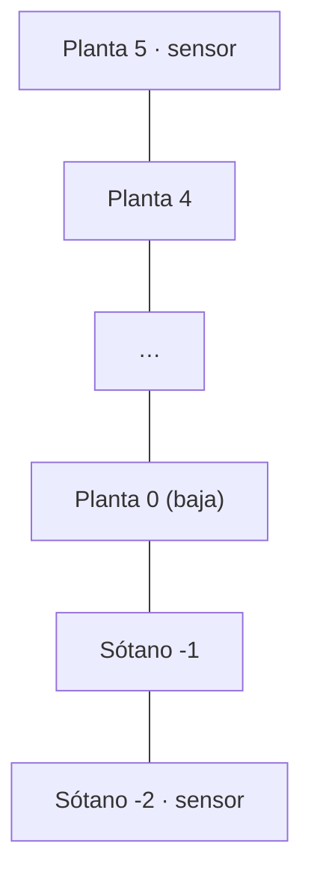
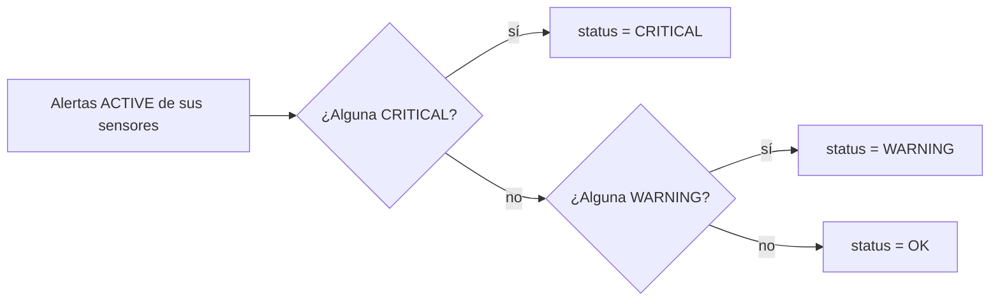
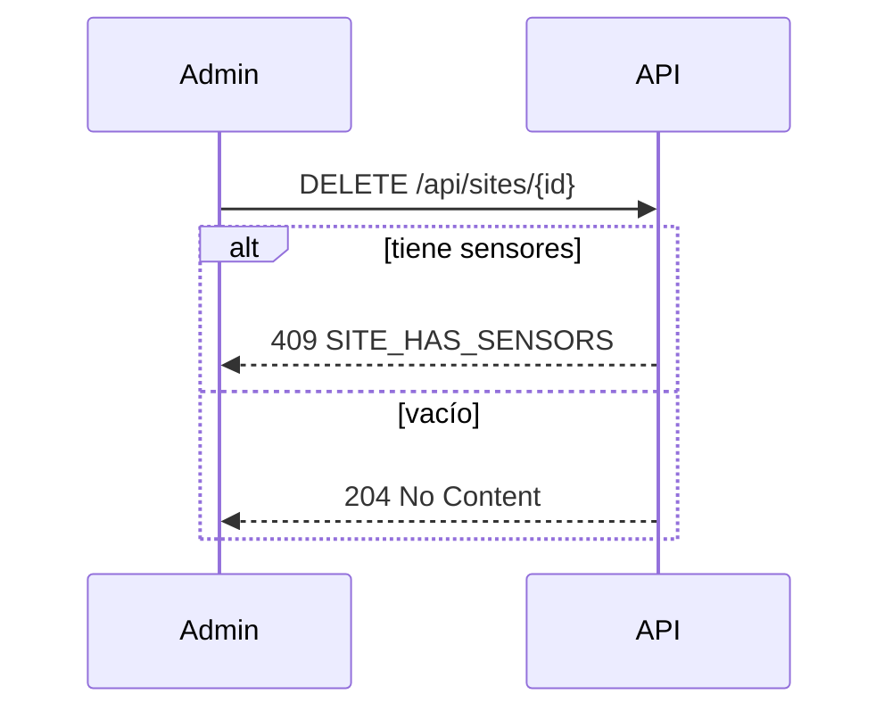

# Diagrama — Issue 14 (B2)

## Plantas de un edificio

`floors = 6` (de la 0 a la 5) y `basements = 2` (la -1 y la -2).
Pasar a `floors = 5` dejaría fuera el sensor de la planta 5 → **422 `FLOOR_OUT_OF_SITE`**.

## Estado del edificio

## Borrado

