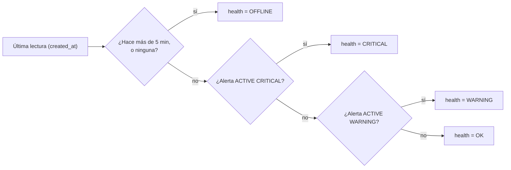
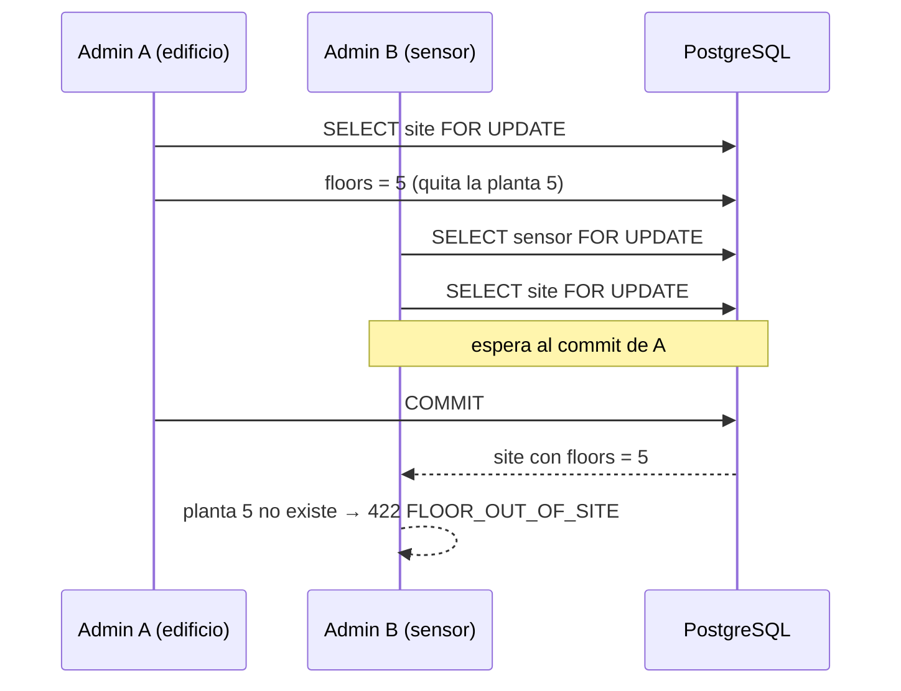

# Diagrama — Issue 15 (B3)

## Salud de un sensor

Una alerta reconocida sigue `ACTIVE`, así que sigue contando.

## Mover un sensor mientras se quitan plantas

Sin el bloqueo, B leía `floors = 6`, daba por buena la planta 5 y el
sensor quedaba fuera del edificio.
